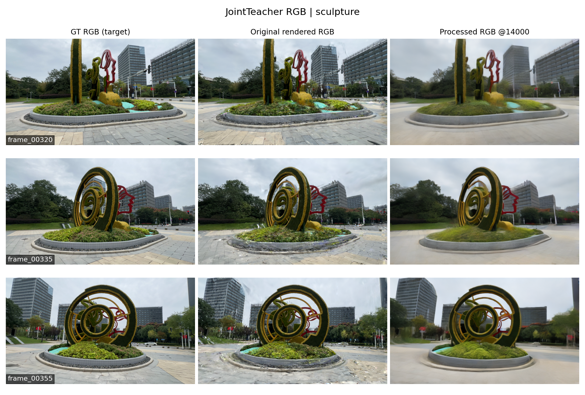
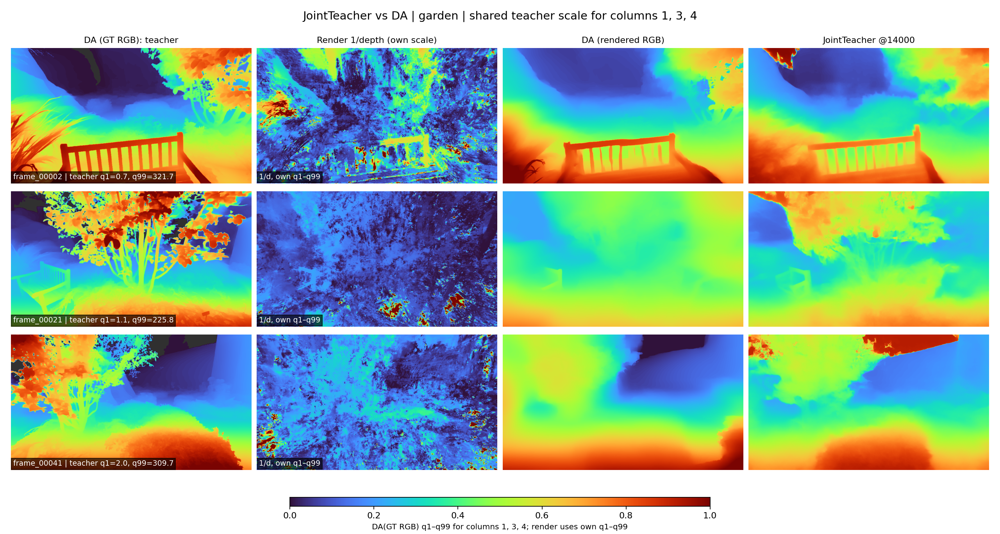

# 面向稀疏视角三维重建的先验学习与引导优化研究——论文研究参考

记录时间：2026-10-22 04:53:46（北京时间，Asia/Shanghai）。

**暂定研究题目：面向稀疏视角三维重建的先验学习与引导优化研究。** 标题概括“跨场景先验学习”和“下游重建引导优化”两部分，并为今后调整预测器输出保留空间。当前归档实现仍是联合 RGB–Depth 预测器引导三维高斯优化；技术叙述和实验结论均按实际实现撰写。旧稿使用过 JARO-GS 暂名，现仅作为历史索引保留。

本文围绕一个研究主线组织：**先训练一个以渲染 RGB/depth 为条件的联合预测器，再将其冻结，用它在渐进伪视角上生成配对外观与相对深度监督，指导三视角高斯重建。** 这两部分构成完整方法：第 3 节是联合预测器训练，第 4 节是下游重建优化策略。

本文供后续写论文、绘制方法图和设计消融时参考。数值来自归档指标；研究动机、已实现机制、实测结果和仍需验证的因果解释分别说明。历史代码/图像中的 JointTeacher、DepthDenoiserJointTeacher 指上游实现，R4、our_R4、our_method 指当前下游运行；在本文的叙述中使用“本文方法”，主表使用 Ours；追溯文件继续使用历史名称。

## 阅读索引

- 第 1–2 节：研究背景、目的、意义与整体设计。
- 第 3 节：方法第一部分——联合 RGB–Depth 预测器训练。
- 第 4 节：方法第二部分——预测器引导的渐进伪视角重建优化。
- 第 5 节：模块动机、继承关系与贡献定位。
- 第 6–8 节：实验设置、上游/下游指标、结果图与场景覆盖。
- 第 9–10 节：证据之间的关系、局限、补充实验与论文写作材料。
- 第 11 节：来源、配套素材和复现索引。

## 1. 研究背景、目的与意义

### 1.1 从三张图重建新视角时，问题在哪里

当前下游任务给定一个场景的三张真实 RGB、相机和初始化点云，希望优化一个能渲染新视角的三维高斯模型。训练视角只约束有限的投影方向；在缺少观测的方向，模型可能产生漂浮结构、模糊边缘、不稳定深度和视角相关伪影。原版 3DGS 在本次 LLFF、DTU 实验中的部分失败渲染，提供了这一问题的直接例子。

本研究关心两个同时存在的目标：外观需要接近可见的真实图像结构，几何需要在未观测方向形成合理的相对层次。只提供一张修复 RGB，仍需说明如何约束三维结构；只给深度先验，也不能直接提供图像外观监督。这是本方法联合设计两种输出的动机，而非关于所有已有方法能力边界的文献结论。

### 1.2 为什么把预测器与重建优化分开

第一部分在跨场景配对数据上学习从不完善渲染到目标 RGB/DA 深度的映射，使预测器可以接收当前重建输出。第二部分在具体场景上冻结预测器，周期性生成伪监督，仅更新该场景的高斯参数。

这种分工把“跨场景训练出的生成先验”和“当前场景的三维优化”连接起来：前者提供外观与相对结构的建议，后者通过可微渲染将建议反馈到三维表示，并持续受真实观测约束。是否比单输出或分开预测更好，需要匹配条件的消融验证；架构中具有两种输出本身不等于已经证明互补增益。

### 1.3 研究目的

1. **构建联合预测器：** 在同一次扩散去噪中，以同视角渲染 RGB/depth 为条件，生成目标 RGB 和 DA 相对深度。
2. **设计下游使用方式：** 明确伪视角如何产生、标签如何刷新、真/伪监督如何切换、RGB/depth 损失如何反馈到高斯。
3. **检验完整方案的适用范围：** 在自然场景和物体中心场景上报告图像质量、逐景覆盖和失效案例，同时检查上游生成结果。

### 1.4 研究意义与当前可支持的范围

本方法将外观伪监督和相对几何伪监督放在同一目标视角、同一次预测中产生，便于在重建优化中联合使用。尺度不定的单目深度通过方向适配和相关性损失接入，不要求预测器提供绝对尺度。周期刷新与真实视角锚点则为生成式监督提供了可执行的反馈机制。

已有结果支持完整方案相对普通稀疏 3DGS 的 PSNR 改善与一定场景覆盖，也显示强基线在部分指标上更好。当前不能把这些结果直接归因于“联合输出”一个因素，不能声称几何真值恢复，也没有计算效率或任意骨干通用性的实验结论。

## 2. 整体方法、术语与信息流

### 2.1 两部分及其连接

| 部分 | 输入 | 输出与用途 | 可优化参数 |
|---|---|---|---|
| 第一部分：联合预测器训练 | 离线渲染 RGB、渲染深度；训练目标为 GT RGB 与 DA(GT RGB) | 训练后的条件联合 RGB–Depth 预测器 | 扩散 UNet 参数 \(\phi\)；VAE、文本编码器冻结 |
| 第二部分：下游重建优化 | 三真实 RGB/相机、初始化点云、目标位姿集合、冻结预测器 | 最终高斯模型及其新视角渲染 | 场景高斯参数 \(\Theta\)；预测器冻结 |

两部分顺序执行。下游没有通过预测器反向传播到上游训练过程，不是端到端同时训练 \(\phi\) 和 \(\Theta\)。

~~~mermaid
flowchart TB
  subgraph UP["第一部分：联合 RGB–Depth 预测器训练"]
    U1["离线渲染 RGB + 渲染 depth"] --> U3["双条件 latent 编码"]
    U2["GT RGB + DA(GT RGB)"] --> U4["配对目标 latent + 扩散加噪"]
    U3 --> U5["共享 UNet：16 通道输入 → 8 通道 velocity"]
    U4 --> U5
    U5 --> U6["联合 velocity MSE；只训练 UNet"]
    U6 --> F["选用 14k 权重并冻结预测器"]
  end
  subgraph DOWN["第二部分：渐进伪视角重建优化"]
    D1["三真实 RGB + 相机 + MVS"] --> G["可优化的三维高斯 Θ"]
    G --> R["真实视角渲染"]
    D1 --> LR["真实 RGB + MiDaS 相对深度损失"]
    R --> LR
    V["目标位姿 + 渐进相机轨迹"] --> P["伪视角 RGB/depth/alpha 渲染"]
    G --> P
    P --> J["冻结预测器：4 步 DDIM"]
    F --> J
    J --> C["配对 RGB/depth 标签池：停止梯度"]
    G --> Q["同伪相机重新渲染：保留梯度"]
    C --> LP["有效区 RGB + Pearson depth 损失"]
    Q --> LP
    LR --> S["随机选择本轮真实或伪损失"]
    LP --> S
    S --> O["反向传播更新高斯；增密与剪枝"]
    O --> G
  end
~~~

图中第一部分的 GT 是训练数据目标。第二部分的留出相机 RGB 只用于评测，不作为伪标签或重建损失目标。最终评测使用优化后高斯模型的渲染，不对测试渲染再做图像修复来替代结果。

### 2.2 统一术语和记号

| 名称/符号 | 本文含义 | 历史命名或容易混淆之处 |
|---|---|---|
| 本文方法 / Ours | 本文完整的两部分方法 | 旧文档用联合方法、R4 描述下游 |
| 联合预测器 \(F_\phi\) | 接收渲染 RGB/depth，同时生成配对 RGB/depth | 文件和旧图仍可能写 JointTeacher；正文用 predictor |
| DA 目标 \(D_{\mathrm{DA}}\) | DA-V2 从 GT RGB 得到的相对深度伪标签 | 不是传感器深度真值 |
| 渲染深度 \(D^r\)、\(D_\Theta(v)\) | 离线数据中的深度，或下游渲染器实际返回的深度张量 | 两者来源分别说明；不预设为米制或 alpha 归一化深度 |
| MiDaS 先验 \(M_v\) | 下游真实训练 RGB 的原有单目深度先验 | 与 DA 训练目标、联合伪深度都不同 |
| \(\phi\) | 上游 UNet 参数 | 第一部分可训练、第二部分冻结 |
| \(\Theta\) | 当前场景高斯参数 | 第二部分持续优化 |
| \(t\) | DDPM/DDIM 扩散时间步 | 不等于 3DGS 优化迭代 |
| \(k\) | 下游高斯优化迭代 | 伪阶段与刷新日程按此计数 |
| 配对伪标签 | 同一相机、同一网格、同一次联合推理的两个输出 | 不等于显式物理一致性约束或多视角一致性证明 |

## 3. 方法第一部分：联合 RGB–Depth 预测器训练

### 3.1 任务定义与样本组成

训练样本记为

\[
\mathcal X=(I^r,D^r,I^\star,D_{\mathrm{DA}}),\qquad
D_{\mathrm{DA}}=\operatorname{DA\!-\!V2}(I^\star),
\]

其中 \(I^r,D^r\) 是同视角离线渲染，\(I^\star\) 是 GT RGB。目标是学习条件联合生成关系

\[
F_\phi:(I^r,D^r)\longmapsto(\widehat I,\widehat D_{\mathrm{rel}}).
\]

训练数据来自清单所指向的配对渲染数据，原目录包含 DIFIX_DL3DV_Benchmark 标记；本次数据范围以实际 train/val 清单为准。清单的五列含义如下。

| 清单列 | 内容 | 本次用途 |
|---|---|---|
| 第 1 列 | 渲染 RGB | RGB 条件 |
| 第 2 列 | 渲染深度 NPY | depth 条件 |
| 第 3 列 | DA(GT RGB) NPY | depth 训练目标 |
| 第 4 列 | DA(rendered RGB) NPY | 当前训练 Dataset 不读取；用于事后 DA 基线比较 |
| 第 5 列 | GT RGB | RGB 训练目标 |

训练清单有 **36,430 对、113 景**，含 **2,712 条 ref 帧**；验证清单有 **715 对、2 景**，含 **48 条 ref 帧**。本次整合直接核对了清单，两集合场景 ID 交集为 0，见[清单核查](research_assets/JARO_GS_20261022_045346/evidence/upstream_split_audit.json)。这只说明这次上游划分的场景 ID 不重叠；不代表已完成上游数据与 LLFF/DTU 的全面重合审计。

### 3.2 RGB 与深度的数值预处理

两路 RGB 缩放到 \(432\times768\)，从 [0,1] 映射到 [−1,1]。对每张深度数组，在有限且大于零的像素内取 1% 和 99% 分位数 \(q_1,q_{99}\)，计算

\[
N_{01}(D)=\operatorname{clip}\left(
\frac{D-q_1}{q_{99}-q_1},0,1\right),\qquad
N(D)=2N_{01}(D)-1 .
\]

条件深度与 DA 目标采用相同归一化规则，但各自独立计算分位数，不能称为“同一数值标尺”。这种处理保留图内相对变化，去除了绝对尺度与偏移。

实际配置对条件和目标均设置 from_depth=true、representation=depth，Dataset 读取时没有取倒数。尽管文件夹名含 inverse，DA-V2 生成脚本保存的是原始、近处数值更大的输出；抽查中渲染深度的数值方向与 DA 相反。本次模型学习的是这套实际输入/目标约定。上游结果图里对渲染深度取倒数仅用于显示，不应据此改写训练过程。

### 3.3 四组 latent：两个条件与两个目标

冻结 VAE 使用确定性编码

\[
E(x)=s\,\mu_{\mathrm{VAE}}(x),\qquad s=0.18215.
\]

单通道深度先复制成三通道，再经同一 VAE 编码。定义

\[
c_I=E(I^r),\quad c_D=E_{\mathrm{depth}}(N(D^r)),\quad
y_I=E(I^\star),\quad y_D=E_{\mathrm{depth}}(N(D_{\mathrm{DA}})).
\]

每组 latent 为 4 通道。静态条件 \(c=[c_I,c_D]\) 有 8 通道，联合目标 \(y_0=[y_I,y_D]\) 也有 8 通道。RGB 与 depth 共享同一目标空间网格，并在后续去噪中由同一 UNet 处理。

### 3.4 基础模型与 16→8 通道扩展

模型从 Marigold 基础权重初始化，UNet 接收

\[
[c_I,c_D,y_t]\in\mathbb R^{16\times h\times w},
\]

输出 8 通道的联合 velocity，前四通道对应 RGB 目标 latent，后四通道对应 depth 目标 latent。文本条件固定为空 prompt embedding；VAE 和文本编码器均冻结。

原 UNet 输入头是 8 通道、输出头是 4 通道。扩展时，旧 RGB 条件权重分别复制到新输入的第 0–3、4–7 通道，旧 noisy-target 权重复制到第 8–11、12–15 通道；输出头权重和偏置复制到两个 4 通道分支。这些参数之后由联合训练更新。本次对应分支是复制初始化，不能写成新分支全部零初始化。

配置模板中的 unet_in_channels=12 会被 trainer 再加 4，运行时检查的实际结构是 16 输入、8 输出。论文应写实际张量结构。

### 3.5 联合扩散过程与 velocity 参数化

每个样本独立、均匀抽取 \(t\in\{0,\ldots,999\}\)，对完整联合目标加噪：

\[
y_t=\sqrt{\bar\alpha_t}\,y_0+
\sqrt{1-\bar\alpha_t}\,\epsilon .
\]

训练使用多尺度噪声，其强度基准为 0.8，并按 \(t/1000\) 退火。scheduler 为 v_prediction，因此网络监督目标是

\[
v_t=\sqrt{\bar\alpha_t}\,\epsilon-
\sqrt{1-\bar\alpha_t}\,y_0,\qquad
\widehat v_\phi=f_\phi(c_I,c_D,y_t,t,e_\varnothing).
\]

这里 \(f_\phi\) 是扩散网络，\(F_\phi\) 是包含编码、采样和解码的完整预测器。UNet 单次输出是 velocity，不是直接 RGB、depth，也不是本次训练中的纯噪声预测。

### 3.6 训练损失：等权的联合 latent velocity MSE

令 batch 大小为 \(B\)，损失为

\[
\mathcal L_{\mathrm{up}}
=\mathbb E\left[
\frac{1}{B\,8hw}
\|\widehat v_\phi-v_t\|_2^2
\right]
=\frac{1}{2}\bigl(\mathcal L_{\mathrm{RGB}}+
\mathcal L_{\mathrm{depth}}\bigr),
\]

其中两个分项分别是对应四通道上的均方误差。实际 reduction=mean，在 batch、通道及完整空间网格上求平均。

代码虽然构造了深度有效 mask，但本次联合 latent 损失不使用该 mask；mask 仍参与原始深度归一化和可视化评估。上游也没有额外的像素级 RGB L1、感知损失、RGB–depth 物理一致性损失或三维重投影损失。论文中的“联合”应落在共享条件、共享去噪网络与配对目标上。

### 3.7 训练流程与实际运行参数

~~~text
对每个训练 batch：
  读取渲染 RGB、渲染 depth、GT RGB、DA(GT RGB)；
  RGB/深度按实际规则缩放并归一化，应用配置中的水平翻转；
  冻结 VAE 编码两个条件与两个目标；
  拼接目标为 8 通道，采样扩散时间步和训练噪声；
  得到 noisy joint target，以 16 通道输入共享 UNet；
  计算 8 通道 velocity MSE，反向传播只更新 UNet；
  按梯度累积更新 Adam 和学习率调度，周期保存与验证。
~~~

实际运行从 2026-10-02 16:46:57 到 2026-10-03 09:12:22，正常完成 15,000 次 optimizer iteration。参数以[运行配置快照](research_assets/JARO_GS_20261022_045346/evidence/upstream_run_config.yaml)为准。

| 设置 | 实际值 |
|---|---|
| 优化器 / 学习率 | Adam / \(3\times10^{-5}\) |
| 有效全局 batch | 32 = 4 GPU × 每卡 4 × 累积 2 |
| 输入网格 | 432×768 |
| optimizer iteration 上限 | 15,000 |
| LR 调度 | IterExponential，总长 18,000；warmup 200；末端比例 0.01 |
| 数值与显存设置 | fp16 AMP、activation checkpointing |
| 扩散训练设置 | DDPM 1000 步；zero-SNR rescale；trailing timestep spacing |
| 增广 | 水平翻转概率 0.5 |
| 验证 | 前期每 500 步，6000 步后每 1000 步 |
| 保存周期 | 1000 步 |
| early stopping 配置 | 10k 步后启用，patience=5 次，min_delta=0.00005 |

模板默认 batch 与实际启动值不同；本次应报告 32。上游整理包记录的环境为 Python 3.10.19、PyTorch 2.4.1+cu118；下游场景优化和 predictor 环境是另行配置的，不能把所有运行合并成一个未经验证的统一环境声明。

### 3.8 验证与 checkpoint 选择

训练中的验证固定 \(t=500\)，使用由 2024+batch_index 决定的 Gaussian 噪声构造带噪目标，报告 velocity 预测的 RGB latent MSE、depth latent MSE 与二者均值。它不执行完整四步生成，也不等于最终采样图像质量。

记录中 joint MSE 最低点在 14k，depth MSE 最低点在 12k；训练实际运行到 15k。14k 的 joint 数值只比 12k 低约 0.0000039，小于 early-stopping 的充分改善阈值。因此可写“采用记录中 joint 验证误差最低的 14k 权重”，不能写成“early stopping 在 14k 自动结束训练”。

下游运行清单将 predictor 指向该历史运行的 iter_014000。下游权重索引记录 UNet 文件 SHA-256 为 5b24319bc96edef789687858a5132dbdece38c2fe64cce8424154d3aaddc290d，见[权重索引](CODE_AND_DATA.md)。原运行路径与迁移副本路径不同，权重身份应依清单及哈希追溯。

### 3.9 预测阶段：四步联合 DDIM 与双路解码

给定渲染 RGB/depth 条件，推理从随机 8 通道目标 latent 开始，执行四步 DDIM 去噪。所得 latent 分成两组：前四通道经 VAE 解码得到 RGB，后四通道经 VAE 解码为三通道再求通道均值得到单通道相对深度，并映射至 [0,1]。

两个输出来自同一次联合推理，但没有显式约束它们必然满足物理几何一致性。上游可视化保存时，还把生成深度逐图以最小二乘 scale/shift 对齐到 DA(GT RGB)，并裁剪为正值。该 GT 辅助的保存行为属于离线评估；第 4 节下游调用的原始预测器输出不执行这种 teacher 对齐。

### 3.10 第一部分的代码定位与复现线索

原上游工程 2610Joint_upstream_codex 中，数据读取在 src/dataset/rgb_invdepth_teacher_dataset.py，训练在 src/trainer/marigold_depth_trainer.py，固定时间步验证在对应 earlystop trainer，VAE/采样在 marigold/marigold_depth_pipeline.py。完整方法与结果的只读文本快照分别见[上游方法](research_assets/JARO_GS_20261022_045346/source_docs/upstream_method.txt)、[上游结果](research_assets/JARO_GS_20261022_045346/source_docs/upstream_results.txt)。

下游包内实际部署的联合推理入口是 [predict_joint](../code/ours/predictor/marigold/marigold_depth_pipeline.py)，由[预测器封装](../code/ours/llff_mvs10k/fsgs_r4_memory_teacher.py)加载、冻结和调度。

## 4. 方法第二部分：联合预测器引导的渐进伪视角重建优化

### 4.1 任务、表示与初始化

给定三张真实 RGB \(I_v^\star\)、真实相机集合 \(\mathcal V_r\)、由三训练图生成的 MVS 点云，以及实验协议规定的目标位姿集合 \(\mathcal V_t\)，优化场景高斯参数

\[
\Theta=\{(\mu_i,s_i,q_i,o_i,c_i)\}_{i=1}^{N},
\]

分别对应位置、尺度、旋转、不透明度与颜色/SH。点数 \(N\) 可以随继承的增密和剪枝机制改变。相机 \(v\) 下的渲染记为

\[
\mathcal R_\Theta(v)
=\bigl(I_\Theta(v),D_\Theta(v),A_\Theta(v)\bigr).
\]

**这里 \(D_\Theta(v)\) 特指训练代码实际取出的 renderer["depth"][0]。** 当前训练入口直接使用该张量；不能把结果图导出时另做的 depth/alpha 处理改写成已经运行过的训练步骤。深度展示与训练张量的区别见第 8 节。

场景优化继承 FSGS 基础框架的优化器、学习率、增密、剪枝、透明度重置和 SH 阶数调度。预测器加载后为 eval 模式，UNet、VAE、文本编码器全部冻结。优化过程中 \(\phi\) 固定，只更新 \(\Theta\)。

### 4.2 真实视角采样：持续使用三张真实观测

维护包含三真实相机的随机栈，每次从栈中不放回抽取一个相机，栈空后重新装入。每次迭代先计算这个真实视角的渲染和损失，再决定本轮最终反向传播使用真实损失还是伪损失。

真实观测持续约束当前场景，避免优化完全依赖生成式目标。这里是采样与损失路由的机制设计，是否减少漂移仍需对应消融；不能用“存在真实分支”直接证明生成误差不会累积。

### 4.3 真实视角损失：RGB 与既有单目深度锚点

真实 RGB 项为

\[
\mathcal L_{\mathrm{RGB}}^r
=0.8\,\|I_\Theta(v)-I_v^\star\|_1
+0.2\,[1-\operatorname{SSIM}(I_\Theta(v),I_v^\star)] .
\]

L1 对完整 RGB 图求平均；真实图不使用伪标签 alpha mask。

真实相机载入时，继承的 FSGS 流程以 MiDaS DPT_Hybrid 为真实训练 RGB 生成深度先验 \(M_v\)。为适应数值表示，使用两个候选中较小的 Pearson 损失：

\[
\mathcal L_d^r
=\min_{T\in\{-M_v,\ 1/(M_v+200)\}}
\left[1-\rho(D_\Theta(v),T)\right],
\qquad
\mathcal L_r=\mathcal L_{\mathrm{RGB}}^r+\lambda_r\mathcal L_d^r .
\]

非有限或近乎常数候选被跳过，两个候选都无效时深度项为零。该项是原有真实视角深度先验，不是联合预测器对真实 RGB 生成的目标。

正常阶段 \(\lambda_r=0.05\)。代码在伪阶段结束后将其降到 0.001，因为修改发生在当轮损失计算之后，精确生效迭代为第 9502 次起。相关实现见[真实深度项](../code/ours/llff_mvs10k/fsgs_r4_mipnerf_depth.py)与[训练循环](../code/ours/llff_mvs10k/train_r4_memory.py)。

### 4.4 目标位姿集合：伪相机要向哪里推进

LLFF 使用全部留出相机位姿作为目标集合。DTU 从每景 31 个留出相机位姿中等距选 8 个，其中 5 个与正式 25-view 评测相机重合。目标集合只定义相机及其位姿，不提供对应 GT RGB 作为伪监督。

因此本次是已知目标位姿的设置。若论文讨论仅三张 RGB 的输入，应同时披露额外目标相机信息。程序可载入测试 RGB 用于评测和构建相机对象；准确说法是“这些 RGB 不进入伪标签生成与重建损失”。

### 4.5 渐进伪视角采样：从当前相机集合向目标推进

实际使用 DifixStageController。初始的 current_poses 为三个真实相机的 camera-to-world 位姿，每到刷新时刻，对每个目标 \(P_j^\star=(R_j^\star,t_j^\star)\) 执行：

1. 从当前相机集合选择最近起点 \(P_a\)。距离为平移欧氏距离与旋转夹角之和：
   \[
   d(P_a,P_j^\star)=\|t_a-t_j^\star\|_2+
   \arccos\left(\operatorname{clip}_{[-1,1]}
   \frac{\operatorname{tr}(R_a^\top R_j^\star)-1}{2}\right).
   \]
   它混合场景坐标下的平移与弧度，是当前实现的选择规则，不是尺度无关的相机度量。
2. 令推进尺度 \(s=0.5\)，按
   \[
   \gamma=\min(s/\|t_j^\star-t_a\|_2,1)
   \]
   对平移插值，旋转按同一 \(\gamma\) 做四元数 SLERP。
3. 当平移加旋转距离已很小、平移近零时直接到目标；插值后剩余平移不超过 \(s\) 时，会将平移吸附到目标。所以不能严格写成每次平移绝不超过 0.5，更不能把 0.5 标成米。
4. 将本轮各目标对应的新伪相机集合作为下一轮 current_poses。以后最近邻起点来自上轮伪相机，不是每次重新从三真实相机开始；某个目标未生成有效标签，位姿列表仍可继续推进。

相机内参与输出尺寸沿实验目标相机的设置。实现见[渐进采样控制器](../code/ours/reconstruction/fsgs_base/utils/progressive_pseudo.py)。

设计动机是从观测邻域逐步进入更难的方向，让周期生成的目标跟随当前三维状态变化。渐进路径是否优于直接使用远处目标相机，仍是待验证的对照问题。

### 4.6 伪标签生成：当前渲染 → 联合预测 → 配对缓存

对伪相机 \(u\)，先无梯度渲染当前 \(\Theta\)，取

\[
M_u^{\mathrm{in}}(x)=
[A_\Theta(u,x)>0.01]\land
[D_\Theta(u,x)>0]\land
[\operatorname{finite}(D_\Theta(u,x))].
\]

有效像素少于 32 时跳过该相机。否则在有效深度内取 1%–99% 分位数，裁剪、归一化到 [0,1]；无效深度填 1。RGB 裁剪至 [0,1]。两路条件按最长边最多 768 像素、长宽为 8 的倍数缩放，再映射至 [−1,1]。

冻结预测器以四步 DDIM 输出 \((\widehat I_u,\widehat d_{01,u})\)，缩放回原渲染网格并 detach。每次推理种子为

\[
\mathrm{seed}(k,j)=2024+1000k+j,
\]

其中 \(k\) 是刷新迭代，\(j\) 是目标序号。固定种子使该次生成可追溯，不代表在不同输入条件间保证输出一致。

标签缓存包含相机、预测 RGB、方向适配后的深度、生成迭代及 RGB/depth 两个有效区 mask。mask 来源于生成标签时的原始高斯渲染，不是预测器学习的置信度。缓存目标可简写为 \(\ell_u=\operatorname{sg}[T(F_\phi(I_\Theta(u),D_\Theta(u)))]\)，其中 \(T\) 包含上述网格恢复与深度方向转换，\(\operatorname{sg}\) 表示不经过标签生成链路反传。预测器只在刷新时调用，反向传播前卸载到 CPU 以控制显存占用。

### 4.7 深度方向适配与尺度处理

DA 目标与 predictor 深度沿近大远小方向。为匹配训练渲染深度的远大近小方向，缓存前使用

\[
\widehat D_u=1-\widehat d_{01,u}.
\]

这一步是数值方向转换；它不是对深度取倒数，也不恢复物理尺度。下游不以对应测试 RGB 计算 DA teacher，也不对伪深度做 GT 辅助 scale/shift 拟合。随后通过 Pearson 相关约束当前渲染与伪深度的相对变化。

预测器训练阶段的方向映射、下游方向转换和展示时的色图方向是三件事，需要在论文实现细节中分别说明。见[方向转换函数](../code/ours/reconstruction/fsgs_base/utils/pseudo_label_utils.py)。

### 4.8 标签池：历史累积与当前批次替换

LLFF 使用 accumulate：保留所有成功刷新的历史标签，训练时从整个池均匀抽取一个；早期靠近训练相机的标签和后期更接近目标的标签可以共存，没有按标签年龄加权。

DTU 使用 replace：成功刷新后用本次标签批次替换旧池，从当前批次均匀抽一个。没有可用标签时回到真实损失。LLFF 与 DTU 使用不同池策略是已运行的配置差异；尚无证据证明这两种策略分别是对应数据集的最优选择。

### 4.9 刷新日程与真/伪迭代切换

场景总共优化 10,000 次。伪阶段为 \(2001\le k<9500\)，计划刷新时刻为

\[
k=2001,2201,\ldots,9401,
\]

共 38 次，每次尝试为全部目标相机生成配对标签。非刷新迭代复用缓存，避免每一步都运行扩散采样。

伪阶段内有标签且损失有效时，以概率约 0.3 使用伪视角、约 0.7 使用真实视角；随机选择使用独立 CPU generator，种子为 2024+17。比例是期望，不保证任意十步固定分配。第 2000 次及之前、第 9500 次及之后仅使用真实损失。

一次真实损失前向计算可能发生在最终选伪损失的迭代中。这里“真/伪交替”定义的是最终反向传播的损失，而非是否执行过真实前向。

### 4.10 伪损失的有效区：标签 mask 与当前渲染共同成立

取出缓存标签后，在同一伪相机重新渲染当前高斯。这次渲染保留梯度，与生成缓存标签时的无梯度渲染分开。RGB/depth 有效区分别为

\[
M_u^q=M_{u,\mathrm{label}}^q
\cap\{A_\Theta(u)>0.01,\ D_\Theta(u)>0,\
\operatorname{finite}(D_\Theta(u))\},
\quad q\in\{\mathrm{RGB},d\}.
\]

这样只在标签生成时和当前渲染都满足有效性要求的位置施加监督。具体分项还剔除相应 RGB/depth 目标及当前值中的非有限像素。有效区阈值来自原始渲染覆盖；预测器补出的所有像素并不会无条件参加监督。

### 4.11 伪 RGB 损失

\[
\mathcal L_{\mathrm{RGB}}^p
=0.8\,\operatorname{MAE}_{M_u^{\mathrm{RGB}}}
(I_\Theta(u),\widehat I_u)
+0.2\,[1-\operatorname{SSIM}(\widetilde I_\Theta(u),
\widetilde{\widehat I}_u)],
\]

其中 \(\widetilde I=MI+(1-M)\) 表示 mask 外填白。MAE 只在有效像素和 RGB 通道上平均；SSIM 是填白后的全图 SSIM。本次未启用“仅完整有效窗口计算 SSIM”的可选开关。

有效像素少于 32 时跳过该项。它把 predictor 生成的配对 RGB 作为外观伪监督，不把测试 GT RGB 加入损失。

### 4.12 伪深度损失与固定系数

\[
\mathcal L_d^p
=1-\rho_{M_u^d}(D_\Theta(u),\widehat D_u),
\qquad
\mathcal L_p=\lambda_I^p\mathcal L_{\mathrm{RGB}}^p+
\lambda_D^p\mathcal L_d^p .
\]

相关性只在有效交集内计算；少于 32 个像素、近乎常数等无效情况跳过该项。一个分项无效时可使用另一个；两个都无有效梯度则回退到真实损失。相关性对正的整体尺度和常数平移不敏感，约束的是相对变化趋势，不是像素深度 L1/RMSE或度量表面误差。

LLFF 的 \((\lambda_I^p,\lambda_D^p)=(0.35,0.01)\)，DTU 为 (0.25,0.02)，有效阶段内固定。代码里虽保留渐变权重函数，本次运行未调用它。

### 4.13 总目标、梯度流与完整算法

令 \(b_k=1\) 表示本轮实际采用有效伪损失，否则 \(b_k=0\)。本次路由等价写作

\[
\mathcal L_k=(1-b_k)\mathcal L_r+b_k\mathcal L_p,
\quad
\nabla_\Theta\mathcal L_k\ \text{用于更新高斯},\quad
\nabla_\phi\mathcal L_k=0.
\]

在标签可用的活动阶段，\(b_k\) 的尝试概率约为 0.3，无效时回退。这里不是每轮都计算 \(\mathcal L_r+\mathcal L_p\) 进行联合反传。历史参数 pseudo_training_mode=difix 指这一交替路由；源码还支持的 joint 相加分支不是当前正式结果所用分支。

~~~text
算法：先验引导的场景优化
输入：三真实 RGB/相机、三图 MVS、目标位姿、冻结联合预测器
初始化高斯 Θ、随机真实相机栈、渐进相机控制器、标签池
for k = 1 ... 10000:
    从真实相机栈不放回取一个相机，渲染并计算 L_real
    if k 为活动阶段的刷新时刻:
        为每个目标位姿选择最近的当前相机并推进
        无梯度渲染 RGB/depth/alpha，检查有效像素
        调用冻结预测器，得到同视角配对 RGB/depth
        对深度执行 1 - prediction，将标签 detach 并更新池
    从池取一个候选标签，按真实概率 0.7 决定是否尝试伪损失
    if 使用伪标签:
        在同一伪相机重新渲染，计算 mask RGB/Pearson depth 损失
        有效则令 L = L_pseudo，否则 L = L_real
    else:
        L = L_real
    对 L 反传，仅更新 Θ，执行继承的增密/剪枝等调度
输出：最终三维高斯和原生新视角 RGB 渲染
~~~

采用伪损失时，增密统计使用该伪视角渲染的 viewspace points、visibility 和 radii；不是更新高斯参数时用伪视角、但增密只看真实视角。伪标签、相机位姿推进和预测器均不通过此损失学习。

### 4.14 已运行参数与一个实际例子

| 机制 | LLFF 本文方法 | DTU 本文方法 |
|---|---|---|
| 真实观测/初始化 | 三 RGB / 三图 MVS | 三 RGB / 三图 MVS |
| 总步数/伪阶段 | 10k / 2001–9499 | 相同 |
| 刷新/推进尺度 | 每 200 次 / 0.5 | 相同 |
| 真实/伪期望比例 | 70% / 30% | 相同 |
| 目标位姿 | 全部留出相机 | 31 个留出位姿中选 8 个 |
| 标签池 | accumulate | replace |
| 伪 RGB/depth 权重 | 0.35 / 0.01 | 0.25 / 0.02 |
| predictor | 同一 14k 权重、四步 DDIM、最长边不超 768 | 相同 |
| 真实 depth 权重 | 0.05，9502 起 0.001 | 相同 |

LLFF room 的实际记录中有六个目标相机，38 次刷新、228 次 predictor 调用，历史标签池最终 228 个标签；采用伪损失的实际迭代为 2289 次，占活动阶段 7499 次的约 30.5%。这是该次运行的机制例子，不应推广成每景固定发生的数量。记录见[room 运行快照](research_assets/JARO_GS_20261022_045346/evidence/llff_room_r4_joint_summary.json)。

详细实现见[下游原方法说明](JOINT_PREDICTOR_3DGS_METHOD.md)、[LLFF 训练入口](../code/ours/llff_mvs10k/train_r4_memory.py)、[DTU 训练入口](../code/ours/dtu/train_r4_memory_dtu.py)、[采样与标签池](../code/ours/reconstruction/fsgs_base/utils/progressive_pseudo.py)、[配对损失](../code/ours/reconstruction/fsgs_base/utils/joint_pseudo_loss.py)。

## 5. 设计动机、继承关系与贡献定位

### 5.1 关键模块的“问题—机制—验证”关系

| 要解决的问题 | 具体设计 | 代码可确认的作用 | 验证其必要性的对照 |
|---|---|---|---|
| 渲染外观与结构都不完善 | 双条件、双目标共享 UNet | 一次推理生成同视角配对输出 | RGB-only、depth-only、分开训练预测器 |
| 生成式深度尺度不定 | 逐图归一化、方向适配、Pearson 损失 | 不要求预测绝对尺度即可参与优化 | 同方向适配的替代深度损失 |
| 目标视角离真实观测较远 | 渐进伪相机推进 | 相机路径逐步向目标扩展 | 直接目标位姿采样 |
| 伪标签会随当前重建状态变化 | 周期刷新、缓存训练 | 生成标签与当前模型保持迭代关系 | 固定标签、不同刷新间隔 |
| 渲染覆盖不可靠 | alpha/深度有效区与交集 mask | 筛除不满足覆盖条件的监督 | mask 阈值及无筛选对照 |
| 持续依赖伪监督可能漂移 | 真视角锚点与随机路由 | 活动阶段仍保持大部分真实监督 | 固定输入条件下改变真/伪比例 |
| 标签保留方式影响历史监督 | accumulate/replace | 两数据集使用不同的缓存策略 | 交叉池策略对照 |

表中“作用”指实现上发生的事；“更稳定”“更准确”等性能解释必须由右列实验支持。

### 5.2 与基础组件的关系

高斯表示与可微渲染来自 3DGS 体系；真实视角深度项、优化和增密等继承 FSGS 基础框架；预训练 VAE/UNet 来自 Marigold；渐进伪相机和伪目标反馈沿 Difix 风格策略组织。本文自己的技术描述应集中在**联合条件/目标的训练、配对 RGB–depth 生成与该配对监督在下游的使用策略**。

可以将论文贡献组织为两点：第一，训练从渲染 RGB/depth 到目标 RGB/DA 相对深度的联合预测器；第二，设计其在渐进伪相机、有效区筛选、标签池和真/伪路由中的接入方式，使配对输出参与具体高斯优化。相关组件的学术归属应在正式论文中引用原始文献；本次整合以实际代码和记录为依据，不将组合自动认定为已完成查新的独立创新。

### 5.3 两阶段深度数据流的区别

| 环节 | 深度来源/目标 | 是否使用对应 GT RGB | 数值处理 |
|---|---|---|---|
| 上游条件 | 离线渲染 NPY | 同一训练样本有 GT，但条件是渲染 | 原值读入，独立 1%–99% 归一化 |
| 上游训练目标 | DA(GT RGB) | 是，作为上游监督数据 | 原 DA 值，独立归一化 |
| 上游保存的可视化深度 | 四步采样输出 | 保存时使用 DA teacher 对齐 | 最小二乘 scale/shift 后保存 |
| 下游真实深度锚点 | 三真实训练 RGB 的 MiDaS | 使用真实训练 RGB | 双表示 Pearson |
| 下游伪深度目标 | 冻结 predictor 原始输出 | 不使用该伪视角 GT RGB | 1−prediction，随后相关性约束 |
| 下游结果图的 Gaussian depth | 从最终 PLY 重渲染 | 不需要测试 GT RGB 来生成高斯深度 | 导出时 depth/alpha，有效性筛选 |
| 下游图中的 DA 参考 | DA(测试 GT RGB) | 仅事后展示使用 | 独立归一化，只作结构参考 |

因此，不能把上游 GT 对齐过的深度文件当作下游伪监督来源，也不能把结果图中的 DA 参考当作训练数据。

## 6. 实验设置与证据结构

### 6.1 三层评估分别回答不同问题

| 层次 | 数据范围 | 指标/展示 | 主要回答的问题 |
|---|---|---|---|
| 上游训练验证 | 715 pair、两景 | 固定时间步 joint/RGB/depth velocity MSE | 训练目标是否被优化 |
| 上游离线采样与 DA 比较 | 六精选帧；另有 100 张保存帧配对误差 | RGB/depth 图、DA proxy nRMSE | 生成结果的结构与当前深度短板 |
| 下游重建评估 | LLFF 八景、DTU 十五景 | RGB PSNR/SSIM/LPIPS、逐景覆盖、RGB/depth 图 | 完整方案在新视角任务上的表现 |

三层指标不能相互替代。上游 MSE 降低百分比不等于采样 RGB 保真度提升百分比；DA proxy 误差的名次也不能直接代替下游重建结果。

### 6.2 下游数据集与划分

LLFF 包含 fern、flower、fortress、horns、leaves、orchids、room、trex 八景；每景三真实训练图，images_4，共 43 张测试图，各景测试数依次为 3、5、6、8、4、4、6、7。所选可视化尺寸为 1008×756。该集合观察植被、薄结构、遮挡与室内布局。

DTU 包含 scan8、21、30、31、34、38、40、41、45、55、63、82、103、110、114，每景训练 RGB 为 rect_023/026/029 三张，约四倍降采样。每景同一组 25 个正式测试视角，共 375 张；所选图约 396×297。该集合观察物体轮廓、果梗、建筑窗框和前景结构。

两数据集合计 23 景、418 个测试视角，分开报告，不能跨全图/mask 协议汇成一个平均指标。

### 6.3 对比方法及训练条件

LLFF 主表包括 3DGS、FSGS、CoR-GS、DNGaussian、DropoutGS、Difix3D+、本文方法。各方法使用同一景由三训练图生成的 MVS 初始化；除 Difix3D+ 为 30k 基础训练+30k 修复续训外，其余均为 10k。所有数字是本地复跑和共同重评。Ours 与 Difix3D+ 可见目标相机位姿，各方法内部损失及先验不同。

DTU 主表为 3DGS、CoR-GS、DNGaussian、DropoutGS、本文方法：前三图 MVS/10k 路线中的方法是 3DGS、CoR-GS 和 本文方法；DNGaussian、DropoutGS 沿作者随机约1000点/6k 路线。随机点盒还依赖本地49相机 COLMAP 几何，DPT loader 有16-bit到8-bit的兼容处理。FSGS 的本地 DTU 移植及不完整 Difix3D+ 10k 改编保留在[诊断目录](../output/dtu/_diagnostics/)，不进入作者路线主表。

这些内容作为实验正文与表注材料；下面两张论文主表只保留方法与指标，每列前三名分别用红、橙、黄标示。

### 6.4 指标与聚合

LLFF 在完整 RGB 上计算 PSNR、Graphdeco SSIM 和 VGG LPIPS。DTU 沿 CoR-GS 25-view mask 口径：PSNR 在通道级 mask==1 的位置计算；SSIM/LPIPS 在预测和 GT 按同一 mask 混合白背景后计算。使用各方法原生最终 RGB，DNGaussian/DropoutGS 颜色输出不能用普通 SH 重画替换。

两个数据集均先取每景视角平均，再取场景等权平均：

\[
\bar m_r=\frac1S\sum_{s=1}^{S}
\left(\frac1{|V_s|}\sum_{v\in V_s}m_{r,s,v}\right).
\]

这里 \(r\) 为运行标识，当前归档主要为单次运行。DTU 表中 ± 是十五景的样本标准差，不是种子标准差。若未来完成三次训练，需要对三个 \(\bar m_r\) 再计算均值和运行间样本标准差。上游训练同样是一次训练记录，不能称三个独立重复。

更完整的口径、逐景表和原始文件指纹见[下游实验参考](results_for_paper/EXPERIMENT_REFERENCE_20261022_040857.md)。

## 7. 上游实验结果、指标及图像

### 7.1 联合去噪验证随训练收敛

下表是固定 \(t=500\) 的验证 latent velocity MSE，均越低越好。原始日志字段仍称 joint_latent_mse 等。表中是训练迭代，不是不同方法；粗体分别标出记录中的最低值。

| Optimizer iteration | Joint latent MSE ↓ | RGB latent MSE ↓ | Depth latent MSE ↓ |
|---:|---:|---:|---:|
| 500 | 0.347668 | 0.425141 | 0.270195 |
| 1000 | 0.320033 | 0.400434 | 0.239633 |
| 1500 | 0.278908 | 0.359816 | 0.198000 |
| 2000 | 0.252385 | 0.329905 | 0.174865 |
| 2500 | 0.238442 | 0.313431 | 0.163453 |
| 3000 | 0.226822 | 0.298737 | 0.154908 |
| 3500 | 0.219411 | 0.291653 | 0.147169 |
| 4000 | 0.217461 | 0.290529 | 0.144392 |
| 4500 | 0.215990 | 0.288495 | 0.143485 |
| 5000 | 0.213621 | 0.284765 | 0.142476 |
| 5500 | 0.212511 | 0.283158 | 0.141864 |
| 6000 | 0.213345 | 0.282692 | 0.143998 |
| 7000 | 0.211143 | 0.280966 | 0.141321 |
| 8000 | 0.210467 | 0.279877 | 0.141056 |
| 9000 | 0.209924 | 0.279676 | 0.140171 |
| 10000 | 0.209166 | 0.278887 | 0.139445 |
| 11000 | 0.208984 | 0.278320 | 0.139648 |
| 12000 | 0.208589 | 0.278027 | **0.139151** |
| 13000 | 0.208910 | 0.278243 | 0.139577 |
| 14000 | **0.208585** | **0.277684** | 0.139486 |
| 15000 | 0.208589 | 0.277734 | 0.139443 |

从 500 到 14k，joint 由 0.347668 降至 0.208585，约下降 40.0%；RGB 由 0.425141 降至 0.277684，约下降 34.7%；depth 由 0.270195 降至 0.139486，约下降 48.4%。约 10k 后接近平台。14k 与15k的 joint 差约 0.00000387，不宜描述为显著性能差距。

**图注材料：** 在两景共715对验证样本上评估固定扩散时间步的 velocity MSE。训练在15k正常结束，14k为记录中的 joint 最低点；曲线说明模型优化了联合去噪目标，不直接量化四步采样图像的质量。完整精度见[验证 CSV](research_assets/JARO_GS_20261022_045346/evidence/upstream_validation_metrics.csv)。

### 7.2 多帧 RGB：布局保留与细节变软

每行同一验证帧，三列依次为 GT RGB、原渲染 RGB、14k预测器四步采样 RGB。历史图仍标 JointTeacher，表示本文第一部分预测器，不是另一个对比方法。

花园选择 frame_00002、frame_00021、frame_00041，覆盖温室、椅子、树和路径的不同视角。生成结果保留主体布局并平滑了破碎纹理，同时细枝叶和路径纹理明显变软。可以描述结构保留与平滑现象，不能将平滑直接等同于图像质量改善。

雕塑选择 frame_00320、frame_00335、frame_00355。圆环雕塑和背景轮廓保留，但原渲染已较接近 GT，生成后局部细节与对比度有损失。当前没有在同一715对验证集上完成原渲染与生成RGB的PSNR/SSIM/LPIPS表，因此本文不把上游RGB称为已经定量优于输入。

### 7.3 深度可视化：与直接 DA 的四列比较

每行同一帧，四列依次为 DA(GT RGB)、渲染深度的显示版本、DA(rendered RGB)、14k联合预测器深度。第2列仅展示时取 \(1/D^r\)，使用自身分位范围；其余三列使用该帧 DA(GT RGB) 的同一1%–99%显示范围。第3列已事后 scale/shift 对齐到teacher，第4列的保存NPY已由训练可视化代码完成对齐。灰色表示无效区域。

花园中联合输出能保留地面、树和椅子的粗结构，部分帧较接近 DA 目标，但细小前景结构更平滑。图例中的 frame_00021 是联合模型较有利的例子，不能替代全部帧统计。

雕塑中直接 DA 与 teacher 的结构较接近；联合模型保留雕塑轮廓，但天空/背景与teacher有明显差异。图中的红色天空不能单独解释为真实天空在近处，它还受预测误差、对齐和显示裁剪影响。

原三列深度图也已归入素材：[花园三列深度](research_assets/JARO_GS_20261022_045346/upstream_figures/garden_depth.png)、[雕塑三列深度](research_assets/JARO_GS_20261022_045346/upstream_figures/sculpture_depth.png)。这些归档图沿原始展示保留，色标文字表示原评估处理；正式论文若重排面板，应将技术说明放入图注并保留同一显示规则。

### 7.4 保存100帧的 DA proxy 定量结果

在14k实际保存的100帧上，将直接DA与已对齐的联合输出放到相同432×768网格，使用双方共同有效像素。目标为 DA(GT RGB)。逐帧计算

\[
\mathrm{nRMSE}_i=
\frac{
\sqrt{\frac{1}{|M_i|}\sum_{x\in M_i}
(\widetilde D_i(x)-D_{\mathrm{DA},i}(x))^2}
}{
q_{99}(D_{\mathrm{DA},i}|M_i)
-q_1(D_{\mathrm{DA},i}|M_i)
}.
\]

这里 \(\widetilde D_i\) 是按记录规则对齐后的预测。直接 DA 逐图以最小二乘拟合到 teacher，联合NPY已在保存时完成拟合。该指标是GT辅助、尺度对齐后的伪标签接近度，不能当成无需GT的绝对深度能力。

| Method | Mean nRMSE ↓ | Median nRMSE ↓ | 更低误差帧数 ↑ |
|---|---:|---:|---:|
| DA(rendered RGB) | 🟥 **0.0915** | 🟥 **0.0324** | 🟥 **78/100** |
| 本文方法的联合预测器 | 🟧 0.1240 | 🟧 0.0835 | 🟧 22/100 |

花园50帧的平均nRMSE，直接DA为0.1624，联合预测器为0.1797，联合输出在22帧更低；雕塑50帧分别为0.0206、0.0684，联合输出没有一帧更低。因此这批样本不支持“联合深度整体优于直接DA”，也不能把六张精选图的直观效果覆盖到全部100帧。

这个比较只评价深度对DA目标的接近程度。它没有评价联合RGB生成，也没有把两种深度放进完全相同的高斯优化流程。下游完整方案的好坏仍需独立任务评估；而要证明联合设计优于直接DA方案，还需要第9节的匹配流程对照。

来源：[逐帧 CSV](research_assets/JARO_GS_20261022_045346/evidence/upstream_da_comparison_100.csv)、[汇总 JSON](research_assets/JARO_GS_20261022_045346/evidence/upstream_da_comparison_100_summary.json)。100张保存帧是715对验证样本的子集，不能混写分母。

## 8. 下游实验结果、场景覆盖及图像

### 8.1 LLFF 论文主表

下表只列方法与指标；初始化、轮数与目标位姿条件已放在第6节。🟥、🟧、🟨分别对应每个指标独立排序的第一、第二、第三名。

| Method | PSNR ↑ | SSIM ↑ | LPIPS ↓ |
|---|---:|---:|---:|
| 3DGS | 14.4799 | 0.4818 | 0.4155 |
| FSGS | 🟨 19.7404 | 🟨 0.6640 | 🟥 **0.2700** |
| CoR-GS | 19.5491 | 🟧 0.6730 | 🟨 0.2732 |
| DNGaussian | 19.3770 | 0.6595 | 0.2831 |
| DropoutGS | 🟥 **19.8039** | 🟥 **0.6797** | 🟧 0.2708 |
| Difix3D+ | 18.4940 | 0.6017 | 0.2842 |
| Ours | 🟧 19.7992 | 0.6587 | 0.2856 |

来源：[LLFF 原始汇总](../output/llff/summary.csv)及[本次快照](research_assets/JARO_GS_20261022_045346/evidence/llff_summary.csv)。历史 our_R4 行在本文表中标为 Ours；数值对应同一运行。

本文方法 相对普通3DGS为 +5.3193 dB PSNR、+0.1769 SSIM、−0.1300 LPIPS。相对 DropoutGS 的 PSNR 低约0.0047 dB，接近其宏平均；DropoutGS 的SSIM更好，FSGS 的LPIPS最低。相对FSGS，本文方法仅高约0.0588 dB PSNR，SSIM与LPIPS均未占优。

这张表支持完整方案的PSNR有竞争力，不支持三项全面最优。Difix3D+为60k两阶段，其他为10k，不能把行间差异当作全部等预算的排名。

### 8.2 DTU 论文主表

所有方法在共同25-view mask协议下重新评测；训练路线依各方法说明不同。± 是十五景样本标准差。

| Method | PSNR ↑ | SSIM ↑ | LPIPS ↓ |
|---|---:|---:|---:|
| 3DGS | 17.753 ± 2.726 | 🟨 0.827 ± 0.085 | 🟧 0.146 ± 0.063 |
| CoR-GS | 🟨 19.319 ± 2.945 | 🟥 **0.856 ± 0.079** | 🟥 **0.121 ± 0.057** |
| DNGaussian | 18.660 ± 2.517 | 0.771 ± 0.139 | 0.182 ± 0.099 |
| DropoutGS | 🟧 20.322 ± 2.338 | 🟧 0.833 ± 0.101 | 🟨 0.159 ± 0.082 |
| Ours | 🟥 **20.325 ± 2.259** | 0.815 ± 0.087 | 0.162 ± 0.076 |

来源：[DTU 原始汇总](../output/dtu/summary.csv)及[本次快照](research_assets/JARO_GS_20261022_045346/evidence/dtu_summary.csv)。这里 DropoutGS 的 PSNR 精确归档值为20.3219316327，显示为20.322；本表沿源CSV数值。

本文方法 相对普通3DGS的PSNR提高约2.5712 dB，但SSIM下降约0.0116、LPIPS上升约0.0157。与DropoutGS的PSNR精确均值仅差+0.002650 dB；CoR-GS在SSIM和LPIPS上最好。因此当前主要优势体现在相对普通3DGS的PSNR，不应将很小的强基线均值差描述为稳定领先。

### 8.3 逐景覆盖：普遍性分析的依据

以下是原始归档逐景统计，方法名称Ours对应本文方法。LLFF表中的交叉重评R4与规范宏平均只有低于0.000004的数值差，属于当前记录的实现数值差异，不改变表中结论。

**LLFF逐景PSNR（dB）：**

| 场景 | 测试图数 | 3DGS | FSGS | CoR-GS | DropoutGS | Ours | Ours − 3DGS |
|---|---:|---:|---:|---:|---:|---:|---:|
| fern | 3 | 15.610 | 20.403 | 20.751 | 20.975 | 21.000 | +5.390 |
| flower | 5 | 15.413 | 19.943 | 20.024 | 19.986 | 19.487 | +4.074 |
| fortress | 6 | 16.778 | 23.047 | 22.913 | 23.193 | 21.359 | +4.580 |
| horns | 8 | 14.642 | 19.666 | 18.665 | 19.421 | 20.211 | +5.569 |
| leaves | 4 | 11.893 | 16.815 | 15.703 | 16.189 | 16.978 | +5.085 |
| orchids | 4 | 14.392 | 15.640 | 15.220 | 16.239 | 16.227 | +1.834 |
| room | 6 | 14.976 | 21.204 | 21.399 | 21.575 | 21.840 | +6.864 |
| trex | 7 | 12.134 | 21.205 | 21.717 | 20.854 | 21.293 | +9.159 |

本文方法相对普通3DGS在八景的三项指标均改善。对DropoutGS，五景PSNR更高；fortress低约1.834 dB，flower低约0.499 dB。对FSGS，六景PSNR更高但只有一景LPIPS更低，说明PSNR覆盖与感知质量覆盖不同。

**DTU逐scan PSNR（dB）：**

| scan | 3DGS | CoR-GS | DNGaussian | DropoutGS | Ours | Ours − 3DGS |
|---|---:|---:|---:|---:|---:|---:|
| scan8 | 15.920 | 21.672 | 19.785 | 20.562 | 20.083 | +4.163 |
| scan21 | 14.437 | 13.997 | 11.779 | 14.114 | 17.872 | +3.435 |
| scan30 | 12.374 | 16.621 | 17.945 | 22.894 | 23.503 | +11.129 |
| scan31 | 15.439 | 16.249 | 17.105 | 17.770 | 19.590 | +4.151 |
| scan34 | 18.676 | 18.772 | 19.481 | 22.026 | 22.685 | +4.009 |
| scan38 | 17.060 | 17.107 | 18.674 | 19.509 | 18.865 | +1.804 |
| scan40 | 15.984 | 17.804 | 16.861 | 20.351 | 17.423 | +1.439 |
| scan41 | 17.939 | 19.390 | 21.316 | 22.623 | 19.077 | +1.138 |
| scan45 | 18.275 | 17.932 | 17.384 | 17.822 | 20.508 | +2.234 |
| scan55 | 21.399 | 22.778 | 18.883 | 21.001 | 19.266 | -2.133 |
| scan63 | 19.994 | 22.864 | 21.846 | 22.519 | 23.295 | +3.301 |
| scan82 | 16.665 | 17.354 | 19.126 | 20.821 | 17.576 | +0.912 |
| scan103 | 20.018 | 23.027 | 22.398 | 21.965 | 22.719 | +2.701 |
| scan110 | 19.630 | 20.753 | 18.376 | 19.573 | 18.727 | -0.903 |
| scan114 | 22.490 | 23.470 | 18.946 | 21.278 | 23.679 | +1.189 |

相对普通3DGS，十三景PSNR提高，两景退化：scan55约−2.133 dB、scan110约−0.903 dB。scan30增益约+11.129 dB；去掉它后，其余十四景平均仍约+1.960 dB。全部十五景增益中位数约+2.234 dB，所以平均增益不只依赖一个特别有利的场景。

**逐景优胜数量与均值差：**

| 数据集 | 对照 | PSNR 优胜景数 | SSIM 优胜景数 | LPIPS 优胜景数 | PSNR 均值差 / dB |
|---|---|---:|---:|---:|---:|
| LLFF | 3DGS | 8/8 | 8/8 | 8/8 | +5.3193 |
| LLFF | FSGS | 6/8 | 4/8 | 1/8 | +0.0588 |
| LLFF | CoR-GS | 5/8 | 2/8 | 2/8 | +0.2501 |
| LLFF | DNGaussian | 6/8 | 4/8 | 4/8 | +0.4222 |
| LLFF | DropoutGS | 5/8 | 2/8 | 3/8 | -0.0047 |
| DTU | 3DGS | 13/15 | 6/15 | 5/15 | +2.5712 |
| DTU | CoR-GS | 9/15 | 1/15 | 1/15 | +1.0053 |
| DTU | DNGaussian | 13/15 | 12/15 | 11/15 | +1.6643 |
| DTU | DropoutGS | 8/15 | 4/15 | 8/15 | +0.0027 |

胜负计数按PSNR/SSIM越高、LPIPS越低为优。对DTU DropoutGS为八景PSNR胜出、七景落后，宏平均接近；对LLFF普通3DGS的覆盖明显更广。由此可支持“相对普通基线的多数场景增益”，不能支持“相对所有强基线普遍胜出”。

更完整的输入条件和逐景来源见[原下游参考](results_for_paper/EXPERIMENT_REFERENCE_20261022_040857.md)，本次对应CSV/JSON均在配套 evidence 中保留。

### 8.4 LLFF RGB/depth 对比图

每组上行为最终RGB、下行为模型重渲染depth。Ours列对应本文方法；Reference列上方为RGB GT、下方为DA(GT RGB)相对深度代理。各方法同一视角使用同一ROI，不对某一列单独校色。

trex观察肋骨、头部和背景弧形结构。普通3DGS有明显颜色混叠、漂浮及深度不连续；本文方法、FSGS、DropoutGS均恢复了较完整主体。普通3DGS的冷色混叠来自归档结果，既有重渲染核对与原图PSNR为59.12 dB，不是绘图时对该列作的色彩调整。

room观察墙面、屏幕与桌面边界。本文方法的局部轮廓相对干净，但深度仍有空洞和不平整，不能称作真实几何恢复。两景均为说明结构现象的精选视角，全集结论以宏平均和逐景表为准。

[主图PDF](results_for_paper/figures/llff_rgb_depth_main.pdf)；[扩展七列图](results_for_paper/figures/llff_rgb_depth_expanded.png)另含CoR-GS和Difix3D+60k，DNGaussian仍保留在定量表。

**图注要点：** 三视角、共同MVS；主图全部10k，扩展Difix3D+60k；同相机RGB/depth；Gaussian每视角共享2%–98%显示范围；DA独立1%–99%归一化，近暖远冷，仅相对结构参考。

### 8.5 DTU RGB/depth 对比图

scan30观察南瓜主体、果梗和表面起伏，scan21观察窗框、墙面和屋顶结构。本文方法在这两例的外观轮廓较完整，普通3DGS和部分对照存在漂浮、残影或模糊。depth可以观察相对层次；RGB颜色纹理不必全部出现在深度上。

所选rect_010_3_r5000.png单视角的前景PSNR，scan30中本文方法为24.584、DropoutGS为23.382 dB；scan21中分别为18.229、13.075 dB，CoR-GS为14.224 dB。这些是有利单视角示例，不能替代十五景均值，尤其不能忽略scan55、scan110的退化。

[DTU主图PDF](results_for_paper/figures/dtu_rgb_depth_main.pdf)。图内按既有要求只保留方法/场景等基本标识，深度来源和色标细节放在图注与正文。

### 8.6 深度图生成与显示的解释边界

结果图中的Gaussian depth来自最终PLY，在同一测试相机用共同depth光栅器重新渲染。该光栅器输出加权深度和 \(D_{\mathrm{sum}}=\sum_iw_iz_i\) 与累计alpha \(A=\sum_iw_i\)，导出显示深度为

\[
D_{\mathrm{shown}}=D_{\mathrm{sum}}/A.
\]

alpha<0.5的像素置为NaN。这个展示阈值与训练伪监督的0.01不同；导出时的depth/alpha也与第4节实际训练直接使用depth张量的记录不同。当前RGB指标来自各方法原生最终RGB，不依赖这个共同depth重渲染器。

LLFF按跨方法全图有效深度、DTU按跨方法共同ROI有效深度的2%–98%分位数确定每视角共同色标。trex为15.63–87.19、room为14.40–48.81、scan30为6.73–7.82、scan21为5.83–8.40相机单位；同一视角所有Gaussian方法共用范围，不能逐方法分别调成看似同样清晰。

Reference的DA-V2从该测试RGB GT运行ViT-L推理，独立归一化，视觉方向统一为近暖远冷。它不是测量GT，颜色不能跨Gaussian/DA直接解释为同一数值。当前没有真实深度误差、DTU表面距离或几何重建精度表。

源文件和处理见[深度导出脚本](results_for_paper/render_depth.py)、[DA参考生成](results_for_paper/make_da_reference.py)、[显示范围](results_for_paper/depth_display_ranges.json)及[定性分析](results_for_paper/QUALITATIVE_ANALYSIS.md)。

## 9. 如何把上下游结果组织成论文证据

### 9.1 当前证据支持的主线

上游验证表明，模型学会了当前定义的双条件、双目标联合去噪任务；采样图表明它能生成具有场景结构的RGB与相对深度，同时存在平滑和局部偏差。下游在两个数据集展示了完整方案相对普通3DGS的PSNR改善，并在强基线中具有接近的宏平均PSNR。

因此目前可以把论文主线写成“训练并使用配对RGB–Depth预测器参与稀疏高斯优化”。当前还不能写成“上游深度更准确，因此下游更好”，因为保存100帧的DA proxy结果并不支持前半句，也没有匹配流程消融验证后半句的因果链。

### 9.2 为什么100帧DA结果与下游结果可以同时成立

两者评价对象不同：100帧比较评价的是对DA(GT RGB)的对齐后单帧深度接近度；下游评价的是整个高斯优化后的RGB新视角质量，期间还有预测RGB、真实监督、标签更新、相机路径、先验和其他优化机制。

一个输出的单帧深度误差较低，不自动意味着它作为优化目标会带来更好的最终渲染；反过来，下游完整方案取得较高PSNR，也不证明其预测深度优于直接DA。这是对评价对象的区分，不是关于联合监督必然互补的实证结论。

要建立两者关系，应将直接DA和联合深度分别接入同一相机、相同RGB目标、相同mask、损失、初始化及预算的重建流程。另需在同一RGB质量指标上评估预测器本身，以免把任务过程中的效果误写成纯图像修复优势。

### 9.3 主张—证据对应表

| 拟写主张 | 现有证据 | 当前状态/准确措辞 |
|---|---|---|
| 一个预测器同时产生配对RGB/depth | 16→8结构、双目标训练、联合采样代码 | 已实现机制；可明确描述 |
| 上游联合去噪目标得到优化 | 715对固定时间步MSE下降 | 支持该验证目标收敛 |
| 生成RGB整体优于原渲染 | 无同一715对PSNR/SSIM/LPIPS表 | 目前只可描述图像现象 |
| 联合深度整体优于直接DA | 100帧中联合仅22帧误差较低 | 本批结果不支持这一主张 |
| 完整方案改善普通稀疏3DGS | LLFF八景PSNR/SSIM/LPIPS；DTU十三景PSNR | 支持限定设置下的完整方案效果 |
| 优于全部强基线 | 三项指标未共同领先 | 应写PSNR有竞争力并报告其他指标 |
| 联合RGB/depth是下游增益的独立来源 | 尚缺控制变量消融 | 需要RGB-only/depth-only和替换深度对照 |
| 渐进采样、标签池是必要机制 | 当前实现与参数记录 | 已实现，必要性与最佳取值待实验 |
| 恢复真实几何 | 只有渲染深度和DA代理展示 | 未建立真实表面/深度精度证据 |
| 多随机种子稳定 | 当前主要是单次运行 | 需要完整重复训练记录 |
| 单一配置跨域通用 | LLFF/DTU池策略及权重不同，目标位姿可见 | 可说同一核心机制在两类场景有结果 |

### 9.4 优先补齐的消融矩阵

| 实验 | 要回答的问题 | 最小对照设计 |
|---|---|---|
| 输出分项 | 两种伪监督各自贡献多少 | 固定同一预测器输出，仅RGB、仅depth、完整双项 |
| 直接DA替换 | 联合depth是否比直接DA更适合重建 | 固定相同伪RGB目标，分别用联合depth和DA深度；披露DA接收的RGB |
| 预测器联合训练 | 共享去噪是否有独立作用 | 联合预测器与分开训练的两个预测器，同等训练数据与推理预算 |
| 条件组成 | 渲染depth输入是否有帮助 | RGB-only条件与RGB+depth条件，保持输出任务一致 |
| 相机路径 | 渐进推进是否更好 | 同目标集合，渐进路径与直接目标位姿 |
| 标签更新 | 周期刷新是否必要 | 固定标签、当前200间隔及另一间隔；报告调用量与成本 |
| 路由和池策略 | 真实锚点与历史监督怎样影响结果 | 真/伪比例对照；两数据集交叉accumulate/replace |
| 位姿先验 | 已知测试目标位姿影响多少 | 目标位姿可见与仅训练相机生成伪位姿两组 |
| 随机与场景稳定性 | 小均值差是否可重复 | 至少三次独立完整训练，报告每次宏平均和运行间标准差 |
| 失效原因 | 哪些目标导致外观或几何退化 | 跟踪scan55、scan110、fortress、flower的伪标签与真实视角误差 |

“仅RGB、仅depth”在这里是需运行的消融，不是已经存在的最终成绩。基线替换时，应固定其他因素；直接把不同训练路线的分数相减，不能识别某一个模块的贡献。

## 10. 后续写论文时可直接参照的材料

### 10.1 题目与贡献组织

暂定中文研究题目为：

**面向稀疏视角三维重建的先验学习与引导优化研究**

如需英文研究题目，可暂译为 **Prior Learning and Guided Optimization for Sparse-View 3D Reconstruction**。它是宽口径研究标题；当前论文方法与实验仍应明确写出联合 RGB–Depth 预测器、渐进伪视角监督和三维高斯优化。

方法组织固定为两部分：

1. **Training the Joint RGB–Depth Predictor / 联合RGB–Depth预测器训练。** 定义渲染双条件、GT RGB/DA双目标、16→8共享UNet、velocity监督与四步采样。
2. **Reconstruction Optimization with Joint Predictions / 联合预测引导的重建优化。** 定义真视角锚点、渐进目标相机、周期标签生成、mask配对损失、池策略和梯度路由。

可在引言末尾将贡献写为“构建联合预测器”“设计下游配对监督接入策略”“在当前两数据集上评价完整方案”。在补齐必要消融和相关工作核对前，不把任何单个组件描述为已证明独立最优或首创。

### 10.2 方法概述参考段落

> 我们提出本文方法，一种由联合预测器训练与场景重建优化两部分组成的稀疏视角高斯重建方案。首先，在配对渲染数据上，以渲染RGB和深度为条件，训练同一扩散网络联合预测目标RGB与由目标RGB生成的DA相对深度。随后固定预测器，在具体场景上从三张真实RGB及其MVS点云初始化高斯表示，沿逐步扩展的伪相机轨迹生成配对外观与相对几何目标。通过有效区域内的图像损失和深度相关性损失，将这些目标反馈到高斯优化；真实视角监督持续提供场景锚点。

### 10.3 第一部分参考段落

> 对于每个训练样本，我们将渲染RGB、渲染深度、GT RGB及其DA深度分别编码成四通道latent。前两者构成静态条件，后两者拼成八通道联合目标。训练时，对联合目标施加DDPM加噪，由十六通道输入、八通道输出的共享UNet预测联合velocity，并在完整latent网格上优化等权MSE。VAE与文本编码器保持冻结。推理从八通道随机latent出发，执行四步DDIM并分别解码RGB和相对深度，因此两种目标在同一相机网格中由同一次预测产生。

### 10.4 第二部分参考段落

> 在场景优化中，预测器参数固定，高斯参数通过真/伪监督随机交替更新。真实视角采用RGB L1与SSIM，以及既有单目深度相关性先验。伪相机从真实相机集合开始，在每次标签刷新时向目标位姿逐步推进；当前高斯渲染的RGB、depth和alpha用于构造有效区及预测器输入。预测器输出经深度方向适配和停止梯度后缓存。训练重新渲染同一伪相机，在标签与当前渲染的共同有效区域内计算RGB损失及Pearson深度损失，仅对高斯反向传播。训练共10k次，活动阶段每200次刷新，有效时约30%的迭代采用伪监督。

### 10.5 实验结果参考段落

> 在LLFF八景的三视角共同MVS初始化实验中，本文方法达到19.7992 dB宏平均PSNR，相对普通3DGS增加约5.32 dB，且八景的SSIM与LPIPS均改善。在DTU十五景的共同25-view前景评测下，PSNR为20.3246 dB，相对普通3DGS增加约2.57 dB，十三景PSNR更高。与强稀疏视角基线相比，平均PSNR接近DropoutGS，但FSGS在LLFF的LPIPS、CoR-GS在DTU的SSIM和LPIPS更好。因此，当前结果支持完整方案在已测设置下的有效性和场景覆盖，同时存在指标取舍与失效场景。

### 10.6 建议的论文图表安排

| 图/表 | 内容 | 现有素材与状态 |
|---|---|---|
| 方法总览图 | 两部分与冻结/更新关系、配对伪标签反馈 | 第2节Mermaid可作为草图，正式版按两部分重画 |
| 预测器结构图 | 四组4通道latent、16→8 UNet、velocity目标 | 第3节公式与代码可直接指导绘制 |
| 下游采样与优化图 | 真相机、渐进伪轨迹、刷新/池/路由/损失 | 第4节流程与伪代码 |
| 上游收敛图 | 三条固定时间步MSE曲线 | 已复制validation_mse.png |
| 上游RGB/depth对比 | 同帧GT、渲染、预测与DA对照 | 花园/雕塑多帧素材已复制 |
| 上游DA proxy表 | 100保存帧与直接DA的配对结果 | 第7.4节；必须保留评估范围和GT辅助对齐说明 |
| LLFF/DTU主表 | Method、PSNR、SSIM、LPIPS | 每列前三名红/橙/黄，配置在正文与表注 |
| 下游定性图 | RGB/depth、同相机与同ROI | trex/room、scan30/scan21；来源和色标在图注 |
| 补充逐景/失效分析 | 二十三景和不利例子 | 第8.3节；进一步补失效景图与轨迹 |

## 11. 素材、来源与复现索引

### 11.1 四份主要输入文档

以下快照在本次整理时逐字节复制，保存为文本以保留原始相对链接文字；它们不是另行改写的解释。本文所需的上游结果图和指标已复制进下游文档包，阅读本页不依赖上游仓库继续挂载。

| 输入 | 本次快照 | 原文件位置 |
|---|---|---|
| 下游完整实验参考 | [downstream_experiments.txt](research_assets/JARO_GS_20261022_045346/source_docs/downstream_experiments.txt) | docs/results_for_paper/EXPERIMENT_REFERENCE_20261022_040857.md |
| 下游原方法说明 | [downstream_method.txt](research_assets/JARO_GS_20261022_045346/source_docs/downstream_method.txt) | docs/JOINT_PREDICTOR_3DGS_METHOD.md |
| 上游结果文档 | [upstream_results.txt](research_assets/JARO_GS_20261022_045346/source_docs/upstream_results.txt) | 2610Joint_upstream_codex/docs/results.md |
| 上游方法文档 | [upstream_method.txt](research_assets/JARO_GS_20261022_045346/source_docs/upstream_method.txt) | 2610Joint_upstream_codex/docs/method.md |

### 11.2 证据与素材目录

[配套目录](research_assets/JARO_GS_20261022_045346/)包含七张上游精选图、验证MSE CSV、100帧DA比较CSV/JSON、上游配置和scheduler快照、上下游数值源及四份文档快照。[manifest.json](research_assets/JARO_GS_20261022_045346/manifest.json)记录复制文件原路径、字节数和SHA-256；本次补充的[划分核查](research_assets/JARO_GS_20261022_045346/evidence/upstream_split_audit.json)记录原清单指纹、数量与场景交集。

下游现有RGB/depth图和LaTeX资产继续位于[results_for_paper](results_for_paper/README.md)，本文方法的历史结果键仍是our_R4，避免丢失逐景追溯关系。图中的Ours列和旧上游图中的JointTeacher属于本文的对应阶段。

### 11.3 复现范围与依赖

上游完整复训仍需要配对训练数据、Marigold基础权重、训练环境及数据路径映射。下游完整复训还需要数据集GT/相机、三图MVS或各方法随机初始化条件、相应原生CUDA扩展和冻结predictor权重。这些外部数据与大模型权重不包含在普通Git素材包中。

现有指标与图片足以阅读、追溯和重建文档中的结果展示；它们不等于已经在全新机器完成一键重训。复算入口、环境与依赖见[REPRODUCE.md](REPRODUCE.md)及[CODE_AND_DATA.md](CODE_AND_DATA.md)。原实验中的绝对路径应视为来源记录，在新机器上映射。

### 11.4 后续更新原则

新实验应按运行种子、初始化哈希、相机划分、预算、预测器权重和最终指标完整归档；更新论文表格时从机器可读指标生成颜色名次。若后续完成三次重复、统一信息条件或新的消融，应再生成一份带时间戳的研究参考，并明确哪些结论由新证据改变。本文记录本次已归档事实与设计逻辑，不把补充计划写成已完成结果。
