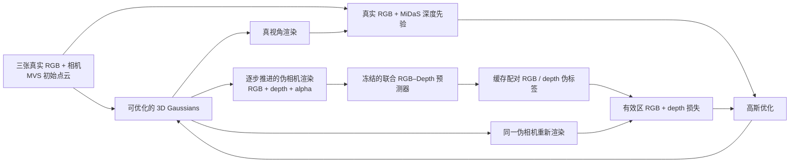

# 面向稀疏视角三维重建的先验学习与引导优化：下游方法细节

暂定研究题目为**面向稀疏视角三维重建的先验学习与引导优化研究**，方法分为**先验学习（当前实现为联合 RGB–Depth 预测器训练）**与**下游重建优化策略**两部分。本页详细记录第二部分；两部分的统一公式、设计动机、研究背景和实验结果见[带时间戳的完整研究参考](JARO_GS_RESEARCH_REFERENCE_20261022_045346.md)。旧稿曾用 JARO-GS 暂名；历史运行标识 R4、our_R4 用于追溯同一组归档结果。

本文记录**当前已经运行的 R4 下游方法**，供论文 Methods、方法图和消融设计使用。重点是训练机制，不是 LLFF/DTU 测评结果。这里的“联合”指**同一个冻结预测器在同一伪视角同时预测 RGB 和 depth**；实际运行的命令行参数 `--pseudo_training_mode difix` 则表示训练时在真视角和伪视角之间切换，不能将二者混为一谈。

实现依据：LLFF 与 DTU 的训练入口分别是 [`train_r4_memory.py`](../code/ours/llff_mvs10k/train_r4_memory.py) 和 [`train_r4_memory_dtu.py`](../code/ours/dtu/train_r4_memory_dtu.py)；共同机制在 [`progressive_pseudo.py`](../code/ours/reconstruction/fsgs_base/utils/progressive_pseudo.py)、[`joint_pseudo_loss.py`](../code/ours/reconstruction/fsgs_base/utils/joint_pseudo_loss.py) 和 [`fsgs_r4_memory_teacher.py`](../code/ours/llff_mvs10k/fsgs_r4_memory_teacher.py)。DTU 的这三个组件有内容相同的实验副本，分别放在 `code/ours/reconstruction/dtu_support/utils/` 和 `code/ours/dtu/`。参数以实际启动命令和这些代码为准，不能只看解析器的默认值。

## 1. 核心思路与信息流

稀疏真视角足以定义基本场景，但未观测方向的 RGB 渲染容易出现缺失、漂浮结构和视角相关伪影。我们先用三张真实图及其 MVS 初始化点云训练 3D Gaussian Splatting（3DGS），再从当前高斯模型在**逐步扩展的伪相机**处渲染 RGB、depth、alpha。冻结的联合预测器以这张渲染 RGB 和 depth 为**条件**，一次生成修复后的 RGB 与预测 depth。二者在同一相机、同一像素网格上成为伪监督；随后重新渲染该伪相机，使用图像损失和相关性深度损失更新高斯参数。伪标签按固定间隔重新生成，因此监督会跟随当前重建状态变化。真实观测则持续提供锚点。



上图的两条损失路径在**不同训练迭代**交替启用；一次伪视角迭代的最终反向传播只使用伪视角损失。预测器不接收测试图像作为伪标签，也不随 3DGS 反向传播更新。图中的 MiDaS 仅用于真实视角的原有深度先验，不能写成联合预测器对真实图生成的监督。

## 2. 变量与初始化

- 高斯参数记为 \(\Theta\)。给定相机 \(v\)，可微渲染器输出 \((I_\Theta(v),D_\Theta(v),A_\Theta(v))\)，分别为 RGB、渲染 z-depth、alpha。优化的是高斯的位置、尺度、旋转、不透明度和颜色/SH 参数；继承 FSGS 的优化、增密与剪枝框架。
- 三个真实训练相机集合为 \(\mathcal V_r\)。相应真实图为 \(I^*_v\)。相机载入时，FSGS 的 `camera_utils.loadCam` 对输入 RGB 用 MiDaS `DPT_Hybrid` 估计单目深度 \(M_v\)，存为 `depth_image`。它是尺度不定的先验，不是传感器 GT 深度。[`camera_utils.py`](../code/ours/reconstruction/fsgs_base/utils/camera_utils.py)、[`depth_utils.py`](../code/ours/reconstruction/fsgs_base/utils/depth_utils.py)。
- 冻结联合预测器记为 \(F_\phi(I,D)=(\widehat I,\widehat D)\)。下游加载第 **14,000** 步选出的联合 RGB–depth UNet 权重和 Marigold base，检查 UNet 为 **16 输入通道、8 输出通道**；UNet、VAE、文本编码器都设为 eval 并冻结。其上游训练目标是同帧 RGB 与深度的联合 latent 扩散预测；权重与配置见 [CODE_AND_DATA.md](CODE_AND_DATA.md)。下游使用它来生成伪标签，不再训练 \(\phi\)。
- \(\mathcal V_t\) 是**目标相机位姿集合**，只定义伪相机要逐步到达的位置。当前伪相机通常还没到达目标位姿。不同数据集如何选 \(\mathcal V_t\) 见第 9 节；该选择是实验协议的一部分。

预测器的上游训练样本把**渲染 RGB、渲染 depth**作为条件，把对应帧的**真实 RGB、从真实 RGB 生成的 DA teacher depth**作为联合目标；两个目标 latent 拼成同一个 8 通道扩散状态，使用联合的扩散预测 MSE 训练。这样，下游调用 \(F_\phi\) 时，单次推理会从同一对渲染条件产生配对的图像和深度。这里的“配对”指同视角、同网格、同一次模型推理；**没有额外显式的 RGB–depth 物理一致性损失**。上游训练细节依据原工作站 `2610Joint_upstream_codex/EXPERIMENT_20261002_JOINT_RGB_DEPTH.md`；该目录不属于本下游仓库，本文已写入理解下游机制所需的训练条件与目标。

## 3. 真视角：采样和损失

每次迭代先从三个真实训练相机构成的随机栈中**不放回抽取**一个相机，栈空后重新装入并随机抽取。代码先计算真实视角渲染与损失，再决定本次是否切换成伪视角损失。[`train_r4_memory.py` 的训练循环](../code/ours/llff_mvs10k/train_r4_memory.py#L315)。

真实视角 RGB 项为

\[
\mathcal L^{r}_{\mathrm{rgb}}=
(1-\lambda_s)\,\|I_\Theta(v)-I^*_v\|_1
+\lambda_s\,[1-\operatorname{SSIM}(I_\Theta(v),I^*_v)],
\qquad \lambda_s=0.2.
\]

这里的 L1 是全图、全通道平均；真实图没有使用伪视角的 alpha 有效区掩码。真实深度项是 FSGS 风格的**双表示 Pearson 损失**：

\[
\mathcal L^{r}_{d}
=\min_{T\in\{-M_v,\;1/(M_v+200)\}}
\bigl[1-\rho(D_\Theta(v),T)\bigr],
\qquad
\mathcal L_r=\mathcal L^{r}_{\mathrm{rgb}}+\lambda_r\mathcal L^{r}_{d}.
\]

\(\rho\) 是展平像素后的 Pearson 相关系数。实现对非有限值或近乎常数的候选做保护：某个候选无效就跳过；两个都无效时深度项为零。[`fsgs_r4_mipnerf_depth.py`](../code/ours/llff_mvs10k/fsgs_r4_mipnerf_depth.py)。正常训练期间 \(\lambda_r=0.05\)；伪阶段结束后代码把它改为 `0.001`（该次迭代计算完才改，因此精确地说从第 **9502** 次开始生效）。这段真实深度损失与伪视角使用的联合预测深度损失不是同一个目标。

## 4. 伪视角：目标位姿和渐进采样

实际实验使用 [`DifixStageController`](../code/ours/reconstruction/fsgs_base/utils/progressive_pseudo.py#L343)，不是代码中另一个单目标、固定插值比例的 `ProgressivePseudoController`。开始时，控制器的 `current_poses` 是三个真实训练相机的 camera-to-world 位姿。每到一次刷新迭代，对每个目标位姿 \(v^*_j\) 独立执行：

1. 在**当前** `current_poses` 中选择最近的起点。距离定义为两相机中心的欧氏距离，加上两旋转矩阵的夹角（弧度）：\(d(a,b)=\|t_a-t_b\|_2+\arccos((\operatorname{tr}(R_a^\top R_b)-1)/2)\)。第一轮候选是真实相机；以后候选是上轮生成的伪相机。实现并非每轮都从固定真实相机出发。[`nearest_anchor_index`](../code/ours/reconstruction/fsgs_base/utils/progressive_pseudo.py#L62)。
2. 从该起点向目标移动。平移先按 \(\alpha=\min(s/\|t^*-t\|_2,1)\) 插值，旋转按同一个 \(\alpha\) 做四元数 SLERP，\(s=0.5\)。代码还有两个到达目标的处理：当“平移距离+旋转角”不超过 \(s\) 或平移几乎为零时直接取目标位姿；插值后若剩余平移距离不超过 \(s\)，会把**平移**直接吸附到目标。故 `0.5` 是推进尺度，不能严格表述成每次平移绝不超过 `0.5`。[`shift_c2w_toward`](../code/ours/reconstruction/fsgs_base/utils/progressive_pseudo.py#L130)。
3. 每个目标得到一个新的伪相机。下一次刷新将这些伪相机作为 `current_poses`，重复最近邻选择和推进；即便某个视角本轮没生成有效伪标签，位姿列表仍会前进。相机内参和图像尺寸使用目标集合中一致的设置。

这种从已有观测附近逐步走向较难视角的路径，是对伪监督可靠性的工程设计：先在较熟悉的相机邻域获得修复标签，再扩展到更大的视角变化。需要注意：**相机位姿路径不是随机地每步采一个全新相机**；随机发生在之后的标签池选择和真/伪迭代选择。`schedule.alpha` 虽记录刷新进度，在本次 `difix` 运行中**不用于上述位姿插值**。

## 5. 伪标签如何生成

在每个刷新时刻、对每个伪相机 \(u\)，先用当前 \(\Theta\) 渲染 \((I_\Theta(u),D_\Theta(u),A_\Theta(u))\)。输入有效区为

\[
M^{\mathrm{in}}_u(x)=
[A_\Theta(u,x)>0.01]\land[ D_\Theta(u,x)>0]\land
[D_\Theta(u,x)\text{ 为有限值}].
\]

少于 **32** 个有效像素时，不调用预测器，也不生成该视角的标签。否则对有效深度的 **1% 与 99% 分位数**做逐图归一化、裁剪到 \([0,1]\)，无效像素填到远平面值 `1`；RGB 裁剪到 \([0,1]\)。输入按最长边最多 `768` 像素且长宽为 8 的倍数缩放，再映射到 \([-1,1]\)。[`JointRgbdTeacher.predict`](../code/ours/llff_mvs10k/fsgs_r4_memory_teacher.py#L113)。

预测器以同一张渲染的 RGB 与 depth 为条件，编码为两个 4 通道 latent；再从随机 8 通道目标 latent 出发，经过 **4 步 DDIM** 联合预测 RGB latent 和 depth latent 并解码。[`predict_joint`](../code/ours/predictor/marigold/marigold_depth_pipeline.py#L126)。每个伪相机用固定随机种子 `2024 + 1000 × 刷新迭代号 + 目标序号`；输出缩放回原始渲染网格并 detach。深度伪标签在入池前按当前代码执行 `1 - predictor_depth01`，使数值方向与渲染 z-depth 对齐。[`align_teacher_depth_orientation`](../code/ours/reconstruction/fsgs_base/utils/pseudo_label_utils.py)。这里**没有**从联合预测深度恢复绝对尺度，也没有用它直接设置高斯点的三维坐标；后续采用相关性损失约束相对深度结构。

一个伪标签包含：伪相机位姿、预测 RGB、经方向转换的预测 depth、生成迭代号，以及用于 RGB 和 depth 的有效区掩码。掩码从**生成标签时的原始高斯渲染**得到，而不是从预测 RGB 的颜色或预测 depth 的置信度学习得到。两个 alpha 阈值在本次运行都为 `0.01`。[`DifixStageController.prepare_iteration`](../code/ours/reconstruction/fsgs_base/utils/progressive_pseudo.py#L400)。预测器仅在刷新标签时运行，反向传播前卸载到 CPU 以释放显存；标签和预测器都不接收高斯优化的梯度。

## 6. 标签池、真/伪视角切换与刷新日程

全程优化 **10,000** 次。伪阶段是 \(2001\leq t<9500\)，每隔 `200` 次刷新一次，即 \(t=2001,2201,\ldots,9401\)，共 **38** 个计划刷新时刻。每次刷新尝试为所有目标相机分别生成一个 RGB–depth 标签。非刷新迭代复用已有标签，无须每步重新运行扩散模型。[`ProgressiveSchedule`](../code/ours/reconstruction/fsgs_base/utils/progressive_pseudo.py#L22)。

标签池有两种实际运行过的策略：

- **`accumulate`**：保留所有成功刷新的历史标签，训练迭代从池中**均匀随机抽取一个**。早期近训练视角和后期更靠近目标的视角共存；不是只选最新阶段，也没有按生成时间加权。LLFF 运行使用此模式。
- **`replace`**：每次成功刷新用本次生成的那批标签替换旧池，再从当前批次均匀随机抽一个。DTU 运行使用此模式。刷新失败而没有当前标签时，训练回到真视角。[`PseudoLabelPool`](../code/ours/reconstruction/fsgs_base/utils/progressive_pseudo.py#L170)、[`prepare_training_label`](../code/ours/reconstruction/fsgs_base/utils/progressive_pseudo.py#L459)。

伪阶段的每次迭代先取一个候选伪标签；随后独立使用种子 `2024 + 17` 的 CPU 随机数，若 \(U\geq0.7\) 就尝试伪视角，否则采用真视角。故在有可用伪标签、损失有效时，**期望约 30% 伪视角、70% 真视角**；这是采样概率而非保证每 10 步恰有 3 步。伪损失整体无有效梯度时也退回真实损失。第 2000 次及之前、以及第 9500 次及以后仅采用真实损失。实际代码在每个迭代都先计算真实损失，即便该次最终切到伪损失；论文中的“交替”指**最终用于反向传播的损失**。[`train_r4_memory.py` 真伪选择](../code/ours/llff_mvs10k/train_r4_memory.py#L350)。

## 7. 伪视角的配对 RGB–depth 损失

取出缓存的伪标签 \((u,\widehat I_u,\widehat D_u,M_u)\) 后，**重新**在同一伪相机 \(u\) 渲染当前高斯；这一步需要梯度，区别于生成伪标签时的无梯度渲染。使用标签有效区与当前渲染有效区的交集：

\[
M^k_u=M^{k,\mathrm{label}}_u\cap
\{A_\Theta(u)>0.01,\ D_\Theta(u)>0,\ D_\Theta(u)\text{ 有限}\},
\quad k\in\{\mathrm{rgb},d\}.
\]

RGB 损失为

\[
\mathcal L^{p}_{\mathrm{rgb}}=
0.8\,\operatorname{MAE}_{M^{\mathrm{rgb}}_u}(I_\Theta(u),\widehat I_u)
+0.2\,[1-\operatorname{SSIM}(\widetilde I_\Theta(u),\widetilde{\widehat I}_u)],
\]

其中 MAE 只对掩码内像素和 RGB 通道平均；\(\widetilde I=M I+(1-M)\) 表示掩码外**白色填充**后计算全图 SSIM。代码默认没有启用“仅完整有效窗口计算 SSIM”的可选开关。若 RGB 有效像素少于 32，则本项跳过。[`masked_rgb_loss_stats`](../code/ours/reconstruction/fsgs_base/utils/joint_pseudo_loss.py#L54)、[`loss_utils.ssim`](../code/ours/reconstruction/fsgs_base/utils/loss_utils.py#L40)。

深度损失为

\[
\mathcal L^{p}_{d}=
1-\rho_{M^d_u}\!\left(D_\Theta(u),\widehat D_u\right),
\qquad \widehat D_u=1-D^{\mathrm{predictor}}_{01,u}.
\]

相关系数只在交集有效像素上计算；不足 32 像素或其中一幅深度近乎常数时，本项跳过。因此此项对**深度的线性变化趋势**施加约束，对正的全局尺度变化与常数平移不敏感；它不是深度像素 L1/RMSE，也不等价于度量深度监督。[`masked_pearson_loss`](../code/ours/reconstruction/fsgs_base/utils/joint_pseudo_loss.py#L40)。

最终伪损失是固定加权和：

\[
\mathcal L_p=\lambda^p_{\mathrm{rgb}}\mathcal L^p_{\mathrm{rgb}}
+\lambda^p_d\mathcal L^p_d.
\]

一个分项无效时仅使用另一项；两项都无效时回退到真实损失。实现中存在旧的 `pseudo_weights()` 渐变函数，但**本次 R4 训练未调用它**：伪 RGB/depth 系数在整个有效阶段固定不变。[`compute_stage_loss`](../code/ours/reconstruction/fsgs_base/utils/progressive_pseudo.py#L471)、[`train_r4_memory.py` 损失调用](../code/ours/llff_mvs10k/train_r4_memory.py#L380)。

## 8. 一次迭代的准确执行顺序

```text
输入：当前高斯 Θ；三个真实相机；伪相机轨迹控制器；冻结预测器 Fφ；标签池
每次迭代 t：
  1. 从三真实相机随机栈取一个，渲染并计算 L_real。
  2. 若 t 是刷新时刻：每个目标位姿找最近当前相机并推进；
     无梯度渲染 RGB/depth/alpha；有效区通过时调用 Fφ 同时预测 RGB、depth；
     对齐深度方向，更新标签池。
  3. 从标签池抽一个候选伪视角，并按 P(真实)=0.7 决定是否尝试伪视角。
  4. 若尝试伪视角：在该相机重新渲染，计算掩码内 L_pseudo；
     有效则令本次 L=L_pseudo，否则 L=L_real。
     若不尝试伪视角：L=L_real。
  5. 对 L 反向传播，仅更新 3D Gaussians；沿用 FSGS 的学习率、增密、剪枝、
     不透明度重置与 SH 阶数调度。若本次用伪视角，增密统计使用其渲染。
```

**公式上的训练目标应写成随机分支**：\(\mathcal L_t=\mathcal L_p\)（有效伪视角轮次）或 \(\mathcal L_r\)（其余轮次），而不是在每轮都写 \(\mathcal L_r+\mathcal L_p\)。源码也支持 `pseudo_training_mode=joint` 的相加路线，但现有 LLFF、DTU 正式 R4 结果使用的均为 `difix` 模式。[`train_r4_memory.py` 损失分支](../code/ours/llff_mvs10k/train_r4_memory.py#L392)、[优化步骤](../code/ours/llff_mvs10k/train_r4_memory.py#L505)。

## 9. 已运行设置中与方法有关的差异

| 机制参数 | LLFF R4 | DTU R4 |
|---|---:|---:|
| 真视角 / 初始点云 | 三训练图 / FSGS MVS | 三训练图 / MVS |
| 目标位姿 | 全部留出相机位姿 | 每 scan 从 31 个留出位姿中等距选 8 个 |
| 位姿推进与刷新 | `0.5`，每 200 次 | `0.5`，每 200 次 |
| 真/伪期望比例 | 70% / 30% | 70% / 30% |
| 伪标签池 | `accumulate` | `replace` |
| 伪 RGB 权重 \(\lambda^p_{\mathrm{rgb}}\) | `0.35` | `0.25` |
| 伪 depth 权重 \(\lambda^p_d\) | `0.01` | `0.02` |
| 真实 depth 权重 \(\lambda_r\) | `0.05`，末段 `0.001` | `0.05`，末段 `0.001` |
| 训练 / 伪阶段 / 预测器 | 10k / 2001–9499 / 同一 14k 权重 | 相同 |

LLFF 数值来自[实际启动命令](../code/ours/llff_mvs10k/run_pipeline.py#L192)。DTU 明示参数来自[启动命令](../code/compare/_dtu_shared/train_scene_dtu.py#L153)，其余来自训练入口默认值和 FSGS [`OptimizationParams`](../code/ours/reconstruction/fsgs_base/arguments/__init__.py#L74)；外部位姿内容见[每景位姿文件](../data/dtu/protocol/pseudo_pose_targets/scan8.json)。此表只为解释**同一机制的实例化**，完整测评另见 [LLFF](LLFF_3view_MVS_10k.md) 与 [DTU](DTU_3view_author_configs.md)。

目标位姿可能与评测相机重合：LLFF 使用全部留出相机位姿；DTU 的 8 个目标中有 5 个与其 25-view 评测集重合。**训练时伪监督来自模型渲染和预测器输出，不使用这些留出视角的 GT RGB 作为伪标签。**但相机 loader 仍会载入测试图用于评测和构建场景相机，不能表述为“程序从未读取测试 RGB”；准确表述是“测试 RGB 不进入伪标签生成和重建损失”。论文必须披露这是已知目标位姿的设置，不能宣称仅凭三张图且完全未知测试位姿。

## 10. 论文表达边界与可检验主张

可以把方法核心表述为：**在渐进生成的伪相机上，用同一个冻结的 RGB–depth 联合扩散预测器，把当前 3DGS 的 RGB/深度渲染转换为同视角的配对外观与几何伪监督；通过有效区筛选、缓存刷新及真/伪视角随机交替，将这两类信号反馈到高斯优化。** 其中“同一次预测、同一视角、两个互补损失”是本实现可直接由代码证明的结构；是否相对已有论文构成独立的新颖性结论，还须用相关工作和消融支撑。

论文中需要区分的机制和待验证效应：

- **确定的机制**：联合预测器同时生成配对 RGB/depth；RGB 项约束外观，Pearson depth 项约束相对几何；真视角保留 GT RGB 和 MiDaS 深度锚点；伪标签是周期刷新且停止梯度的。
- **合理假设、需实验支持**：配对 RGB/depth 比只用 RGB 或只用 depth 更好；渐进视角比直接在远距离目标位姿修复更稳定；`accumulate` 与 `replace` 的差异与数据集特性有关。不能把这些假设写成已证明结果。
- **继承与改造**：3DGS/FSGS 的高斯优化和真视角损失、Difix 风格的渐进伪相机策略是基础组件；本文下游的具体组合、联合 RGB–depth 伪监督及训练协议应与这些基础清楚区分。

复现入口、数据/权重依赖见 [REPRODUCE.md](REPRODUCE.md) 和 [CODE_AND_DATA.md](CODE_AND_DATA.md)。
