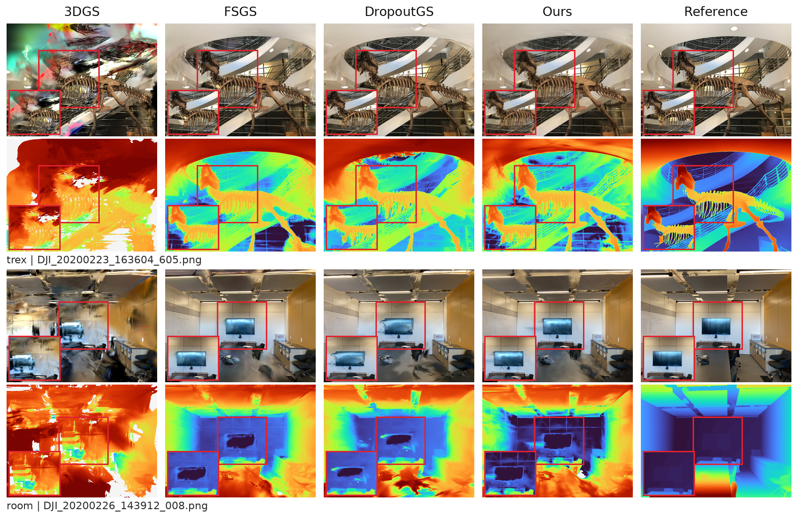
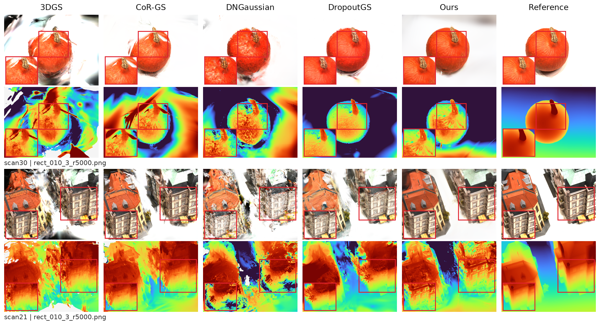

# 下游实验与论文写作参考：LLFF、DTU 三视角重建

记录时间：2026-10-22 04:08:57（北京时间，Asia/Shanghai）。

本文将数据集选择、方法范围、实际训练条件、共同测评方式、定量表格、RGB/depth 图和跨场景分析组织成一份论文实验参考。主要依据是 [既有定性分析](QUALITATIVE_ANALYSIS.md)、[LLFF 审计](../LLFF_3view_MVS_10k.md)、[DTU 审计](../DTU_3view_author_configs.md)、机器可读指标及方法代码。本文表格按本次记录时的归档数值固化，图像链接指向现有素材；后续若替换拼图，应同时记录对应相机与模型。

## 1. 实验要回答的问题

研究问题是：只有三张真实 RGB 用于重建时，能否利用冻结的联合 RGB–depth 预测器，在逐步扩展的伪视角上提供配对外观与相对几何监督，从而改善新视角渲染？

当前实验提供三类证据：

1. **定量质量：** 在 LLFF 与 DTU 的场景宏平均上比较 PSNR、SSIM、LPIPS，检查增益落在哪些指标。
2. **场景覆盖：** 检查逐景提升、退化与胜率，判断平均增益是否只来自少数有利场景。
3. **定性现象：** 用同一测试相机的 RGB 与渲染深度观察轮廓、遮挡、薄结构、平面和漂浮伪影，解释数值背后的变化。

联合预测器输出的两个目标是否互补、渐进采样是否必要、刷新日程是否更好，仍需单独消融。主表比较的是完整训练方案。

## 2. 选择的数据集与覆盖范围

| 项目 | LLFF | DTU |
|---|---|---|
| 当前纳入范围 | 8 个场景 | 15 个 scan |
| 场景列表 | fern、flower、fortress、horns、leaves、orchids、room、trex | scan8、21、30、31、34、38、40、41、45、55、63、82、103、110、114 |
| 真实训练 RGB | 每景 3 张；具体文件按场景清单固定 | 每景 rect_023_3_r5000.png、rect_026_3_r5000.png、rect_029_3_r5000.png |
| 测试规模 | 共 43 张；各景数量不同 | 每景 25 张，共 375 张 |
| 输入分辨率 | images_4；所选图为 1008×756 | 约 1/4 分辨率；所选图约 396×297 |
| 指标空间 | 完整 RGB 图像 | CoR-GS 前景 mask 协议 |
| 初始化原则 | 每景所有主表方法共享三训练图生成的 MVS PLY | 3DGS、CoR-GS、Ours 用三图 MVS；DNGaussian、DropoutGS 沿随机点作者路线 |
| 主要观察对象 | 场景层次、遮挡、植被细节、室内平面与薄结构 | 物体轮廓、果梗、建筑窗框、表面与背景分离 |
| 定性图 | trex、room | scan30、scan21 |

选择这两组数据的目的，是在自然场景与物体中心场景中检查同一联合伪监督思路。两者合计覆盖 23 景、418 个测试视角；由于 mask、图像内容与视角数量不同，本文分别报告两个数据集，不能把 418 张图直接混成一个总分。

LLFF 的八景包括植被、室内布局和复杂骨架/遮挡结构。DTU 的十五景用于观察受控物体拍摄条件下的外观重建。这里的 DTU 结果是 RGB 新视角质量，未开展基于测量表面的几何精度评测。

划分与输入追溯见 [LLFF 协议](../../data/llff/protocol/)、[DTU 三视角划分](../../data/dtu/protocol/splits/cor_gs_3view/)及 [复现说明](../REPRODUCE.md)。

## 3. 对比方法及纳入理由

下表概括归档代码所采用的机制与本地路线。它用于解释当前实验，不替代相关工作章节的原论文论述。

| 方法 | 归档实现中的主要机制 | LLFF 主表 | DTU 主表 | 在比较中的作用 |
|---|---|---|---|---|
| 3DGS | 原版高斯优化与 SH 颜色渲染；本地改用三图 MVS 起点 | MVS / 10k | MVS / 10k | 说明在相同稀疏输入起点下，完整方法相对普通重建的变化 |
| FSGS | 伪视角、深度先验与增密 | MVS / 10k | 不列，保留移植诊断 | 对照已有稀疏视角优化框架 |
| CoR-GS | 双高斯、co-pruning、co-regularization | MVS / 10k | 三图 MVS / 10k，作者 DTU 路线 | 对照多模型一致性正则 |
| DNGaussian | 深度及形状约束，保留相应原生颜色渲染实现 | 本地 LLFF MVS / 10k | 随机约 1000 点 / 6k | 对照几何先验约束 |
| DropoutGS | dropout 与一致性约束；LLFF 本地配置含 dropout 0.4、一致性权重 0.4 | MVS / 10k | 随机约 1000 点 / 6k | 强稀疏视角正则基线 |
| Difix3D+ | 先基础重建，再用图像修复生成的伪视角继续优化 | MVS / 30k + 30k | 不列完整作者路线结果 | 对照生成式外观修复 |
| Ours (R4) | 同一冻结联合预测器同时生成配对 RGB/depth 伪标签，再反馈到高斯优化 | MVS / 10k | MVS / 10k | 本文完整方案 |

DTU 主表采用目前完成的作者路线本地复跑，而非原论文数值摘录。FSGS 的 DTU 运行是本地移植，缺少作者原生 DTU 入口；Difix3D+ 的 DTU 已测项仅为 10k 改编，未完成与其完整两阶段路线对应的复跑，因此不纳入这张作者路线表。两者及强制 MVS/10k 的 DNGaussian、DropoutGS 结果保存在 [诊断归档](../../output/dtu/_diagnostics/)，并非因表中名次而替换或删除原始结果。

LLFF 定性图依当前选图方案去掉 DNGaussian，但定量表保留；主图展示 3DGS、FSGS、DropoutGS、Ours 和 Reference，扩展图另加 CoR-GS、Difix3D+。DTU 定性图与五方法主表一致。

### 3.1 本地代码与配置入口

| 内容 | 入口或索引 |
|---|---|
| 原版 3DGS | [代码与运行器](../../code/compare/vanilla_3DGS/) |
| LLFF 对比方法 | [compare 目录](../../code/compare/)下各方法的 llff_mvs10k/source 与 config；Difix3D+ 使用 Difix3D_60k/llff_mvs_60k |
| DTU 作者随机点路线 | [作者路线运行器](../../code/compare/_dtu_author_runner/)与对应方法 dtu_author/source |
| 我们的 LLFF 入口 | [run_pipeline.py](../../code/ours/llff_mvs10k/run_pipeline.py)、[train_r4_memory.py](../../code/ours/llff_mvs10k/train_r4_memory.py) |
| 我们的 DTU 入口 | [train_r4_memory_dtu.py](../../code/ours/dtu/train_r4_memory_dtu.py) |
| 冻结联合预测器 | [predictor](../../code/ours/predictor/)；权重依赖见 [CODE_AND_DATA.md](../CODE_AND_DATA.md) |
| 机制、采样和损失详解 | [JOINT_PREDICTOR_3DGS_METHOD.md](../JOINT_PREDICTOR_3DGS_METHOD.md) |

## 4. 我们的方法在两个数据集中的实例化

先从三张真实 RGB 及其三图 MVS 点云建立高斯模型；在逐步向目标位姿推进的伪相机上渲染 RGB、depth、alpha。冻结预测器接收当前 RGB/depth 渲染，单次推理输出配对的修复 RGB 与预测相对深度；缓存后，在同一伪相机重新渲染并计算监督，梯度只更新高斯。真实视角持续使用 GT RGB 和原有 MiDaS 深度先验作为锚点。

伪 RGB 使用有效区 L1 与 SSIM，伪深度使用 Pearson 相关性损失。监督强调相对结构，不恢复绝对深度尺度。最终反向传播在真实损失和有效伪损失之间随机切换，并非每次都将二者相加。预测器固定使用同一份 14k 上游联合权重，整个下游阶段不更新。

| 参数或机制 | LLFF R4 | DTU R4 |
|---|---|---|
| 训练总轮数 | 10,000 | 10,000 |
| 伪阶段 | 第 2001–9499 次 | 相同 |
| 伪标签刷新 | 每 200 次，共 38 个计划时刻 | 相同 |
| 推进尺度 | 0.5 | 0.5 |
| 真/伪期望比例 | 70% / 30%，有可用伪标签时 | 相同 |
| 标签池 | accumulate，保留历史标签 | replace，用新批次替换 |
| 伪 RGB / depth 权重 | 0.35 / 0.01 | 0.25 / 0.02 |
| 真实 depth 权重 | 0.05，末段降至 0.001 | 相同 |
| 目标位姿集合 | 全部留出相机位姿 | 从 31 个留出位姿等距选 8 个 |
| 与正式评测相机的关系 | 可使用正式评测相机位姿 | 8 个中有 5 个与 25-view 测试集重合 |

这提供的是同一机制在两个数据集中的验证；标签池和损失系数有数据集适配，不能写成单一完全不调参配置，也不能据此声称任意重建骨干都能直接获益。

测试 RGB 不进入伪标签生成或重建损失。程序仍可载入测试图用于评测和相机构建，准确表述应为“训练监督不使用测试 RGB”。已知目标位姿属于训练信息条件，需在实验设置中披露。

## 5. 共同评测逻辑与数据集差异

### 5.1 LLFF：完整图像共同评测

所有方法的最终原生 RGB 渲染与同一批 GT 配对，数值文件名通过 view mapping 映射回真实测试图。RGB 从 8-bit PNG 转为 [0,1]；全图计算 PSNR、Graphdeco SSIM 和 VGG LPIPS。GT、大小和视角对应关系必须一致，不能以一张相近视角代替。

对第 s 景、第 v 个测试视角的指标记为 m(s,v)，报告

\[
m_s=\frac{1}{|V_s|}\sum_{v\in V_s}m(s,v),\qquad
\bar m=\frac{1}{S}\sum_{s=1}^{S}m_s .
\]

LLFF 使用 S=8，各景测试数为 fern 3、flower 5、fortress 6、horns 8、leaves 4、orchids 4、room 6、trex 7，共 43。场景等权，所以不能将 43 张图不分场景直接平均来替代主表。PSNR 先逐图计算再平均，也不能先合并全部像素 MSE 再取对数。

除 Difix3D+ 采用 60k 两阶段训练外，主表方法均为共同 MVS/10k。Difix3D+ 报告的是最终 60k 模型的原始三维渲染，非 render-time 修复图。Ours 与 Difix3D+ 可见目标相机位姿；同点云和同轮数不代表所有先验、日程和训练信息相同。

### 5.2 DTU：25-view 前景评测

每个 scan 固定同一组 25 个正式测试视角。部分模型归档有 31 张留出渲染，但只有规范中的 25 张参加本表；不能把 31-view 全图指标混入主表。

前景 PSNR 采用 CoR-GS 实现口径：mask 缩放至 GT 分辨率后，在通道级 mask==1 的位置计算 RGB MSE，并计算 −10 log10(MSE)。SSIM 与 VGG LPIPS 则先将预测和 GT 按相同 mask 混合到白背景，再执行对应实现；边缘 mask 值的处理也沿用代码，不能用任意二值阈值替换。

DTU 同样先平均每景 25 张，再对 15 景等权平均。由于景内数量相同，两级平均在均值上等价于全部 375 个逐图指标等权平均，但场景层级仍须保留，便于报告景间波动与逐景胜负。

DNGaussian、DropoutGS 的 RGB 要由各自原生神经颜色渲染器产生，不能改用普通 SH 渲染器重画后评分。它们的随机初始化约 1000 点、训练 6k，采样盒依赖处理包中 49 相机 COLMAP 几何；本地深度 loader 还有将 16-bit 归一化 DPT 图量化成 8-bit 的兼容处理。其他主表方法使用三图 MVS/10k。因此这张表是共同测试口径下各自训练路线的比较。

### 5.3 重复运行与统计量的定义

本次可追溯归档中，LLFF 主要运行种子为 2024；DTU 的 3DGS、CoR-GS、R4 记录 seed 2024，DNGaussian、DropoutGS 作者路线记录 seed 0。每方法每景目前对应一份已归档运行，本文数值不标作三次独立重复的平均。

DTU 表中的 ± 定义为十五景样本标准差：

\[
s_{\mathrm{scene}}
=\sqrt{\frac{1}{S-1}\sum_s(m_s-\bar m)^2},\quad S=15.
\]

后续完成 R=3 次独立重复时，先对每次完整运行按上述视角→场景层级得到宏平均 \(\bar m_r\)，再计算

\[
\mu_{\mathrm{run}}=\frac{1}{3}\sum_{r=1}^{3}\bar m_r,\qquad
s_{\mathrm{run}}=\sqrt{\frac{1}{2}\sum_{r=1}^{3}(\bar m_r-\mu_{\mathrm{run}})^2}.
\]

三个场景、三个训练视角、对同一 PNG 重评三次都不等于三个独立训练重复。届时应记录每次的种子、配置、模型与逐景指标；景间标准差和运行间标准差要分开标注，不能把现有 ± 直接改名为三次重复误差。

指标实现与复算入口：[LLFF 原始共同评测](../../code/evaluation/llff/compute_unified_metrics_original.py)、[DTU mask 评测](../../code/evaluation/dtu/evaluate_corgs25_mask.py)、[归档复算脚本](../../code/evaluation/reevaluate_archive.py)。

## 6. 两个数据集的论文格式定量主表

论文主表只保留方法名和指标；每个指标单独排序，第一、第二、第三名分别用红、橙、黄底色标出。颜色名次针对该列独立计算，不代表综合排名。以下阅读版用 🟥、🟧、🟨 对应 LaTeX 表格的底色。

### 6.1 LLFF：共同三图 MVS，Difix3D+ 为 60k

| Method | PSNR ↑ | SSIM ↑ | LPIPS ↓ |
|---|---:|---:|---:|
| 3DGS | 14.4799 | 0.4818 | 0.4155 |
| FSGS | 🟨 19.7404 | 🟨 0.6640 | 🟥 **0.2700** |
| CoR-GS | 19.5491 | 🟧 0.6730 | 🟨 0.2732 |
| DNGaussian | 19.3770 | 0.6595 | 0.2831 |
| DropoutGS | 🟥 **19.8039** | 🟥 **0.6797** | 🟧 0.2708 |
| Difix3D+ | 18.4940 | 0.6017 | 0.2842 |
| Ours (R4) | 🟧 19.7992 | 0.6587 | 0.2856 |

表注配置：所有方法共享三图 MVS 初始化；除 Difix3D+ 用 30k 基础训练加 30k 修复续训外，其余为 10k。Ours 与 Difix3D+ 使用留出相机位姿。更细的损失、先验和信息条件见[LLFF 审计](../LLFF_3view_MVS_10k.md)。

来源：[LLFF summary.csv](../../output/llff/summary.csv)。粗体标示该指标最优；完整阅读版见 [LLFF_TABLE.md](LLFF_TABLE.md)。

Ours 相对普通 3DGS 的增益为 +5.3193 dB PSNR、+0.1769 SSIM、−0.1300 LPIPS。三项方向一致，说明完整方案对这组稀疏输入的基线有帮助。

相对强基线，Ours 与 DropoutGS 的 PSNR 分别为 19.7992、19.8039 dB，相差 −0.0047 dB；DropoutGS 的 SSIM 也更高。FSGS 的 LPIPS 最低，Ours 相对 FSGS 仅增加约 0.0588 dB PSNR，而 SSIM 和 LPIPS 均未占优。因此应写“PSNR 有竞争力、接近最优基线”，不能写“三项全面最优”。

Difix3D+ 为六倍迭代预算的两阶段运行，Ours 为 10k。两行的数值差异可如实报告，但只比较迭代次数也不能推出总计算量六倍或运行效率结论，因为预测器推理与不同实现的每步成本均不同。

### 6.2 DTU：作者路线本地复跑，共同 25-view mask

| Method | PSNR ↑ | SSIM ↑ | LPIPS ↓ |
|---|---:|---:|---:|
| 3DGS | 17.753 ± 2.726 | 🟨 0.827 ± 0.085 | 🟧 0.146 ± 0.063 |
| CoR-GS | 🟨 19.319 ± 2.945 | 🟥 **0.856 ± 0.079** | 🟥 **0.121 ± 0.057** |
| DNGaussian | 18.660 ± 2.517 | 0.771 ± 0.139 | 0.182 ± 0.099 |
| DropoutGS | 🟧 20.322 ± 2.338 | 🟧 0.833 ± 0.101 | 🟨 0.159 ± 0.082 |
| Ours (R4) | 🟥 **20.325 ± 2.259** | 0.815 ± 0.087 | 0.162 ± 0.076 |

表注配置：3DGS、CoR-GS 和 Ours 使用三图 MVS/10k；DNGaussian、DropoutGS 使用作者路线的随机约 1000 点/6k。Ours 使用 8 个留出相机位姿，其中 5 个与测试相机重合，没有使用测试 RGB 训练。± 为十五个 scan 的样本标准差。其余训练配置和测试信息条件见[DTU 审计](../DTU_3view_author_configs.md)。

来源：[DTU summary.csv](../../output/dtu/summary.csv)。± 均为景间样本标准差。指标以源 CSV 为准，避免手工修改的表格与逐景结果发生分离。

Ours 的 PSNR 为 20.3246 dB，普通 3DGS 为 17.7534 dB，增加约 2.5712 dB。但 SSIM 下降约 0.0116，LPIPS 上升约 0.0157，当前改善主要反映在 PSNR。

Ours 与 DropoutGS 的精确均值差为 +0.002650 dB；这不能作为稳定领先的证据。CoR-GS 的 SSIM 0.856、LPIPS 0.121 最好；Ours 对应为 0.815、0.162。表格显示不同指标之间存在取舍，不能仅选最高 PSNR 作为完整质量结论。

## 7. 跨场景覆盖与普遍性分析

### 7.1 LLFF 逐景 PSNR

| 场景 | 测试图数 | 3DGS | FSGS | CoR-GS | DropoutGS | Ours | Ours − 3DGS |
|---|---:|---:|---:|---:|---:|---:|---:|
| fern | 3 | 15.610 | 20.403 | 20.751 | 20.975 | 21.000 | +5.390 |
| flower | 5 | 15.413 | 19.943 | 20.024 | 19.986 | 19.487 | +4.074 |
| fortress | 6 | 16.778 | 23.047 | 22.913 | 23.193 | 21.359 | +4.580 |
| horns | 8 | 14.642 | 19.666 | 18.665 | 19.421 | 20.211 | +5.569 |
| leaves | 4 | 11.893 | 16.815 | 15.703 | 16.189 | 16.978 | +5.085 |
| orchids | 4 | 14.392 | 15.640 | 15.220 | 16.239 | 16.227 | +1.834 |
| room | 6 | 14.976 | 21.204 | 21.399 | 21.575 | 21.840 | +6.864 |
| trex | 7 | 12.134 | 21.205 | 21.717 | 20.854 | 21.293 | +9.159 |

逐景来源：[3DGS/R4 共同重评](../../output/llff/source_metrics/crosscheck/vanilla_ours_common_4.json)与 [对比方法共同评测](../../output/llff/source_metrics/UNIFIED_METRICS.json)。逐景表使用交叉重评数值，主表仍采用 summary.csv 的规范值；R4 两份记录有小于 0.000004 的宏平均数值差，本文不把这种实现数值误差解释为方法差异。

Ours 对 3DGS 在八景的三项指标全部改善，PSNR 增量约为 +1.83 至 +9.16 dB。这比只展示 room、trex 两景更能支持“对普通稀疏重建的增益覆盖多种场景”。

相对更强的 DropoutGS，Ours 在五景 PSNR 更高，但在 fortress 明显落后：21.359 对 23.193 dB，约 −1.834 dB；flower 也约低 0.499 dB。相对 FSGS，Ours 在六景 PSNR 更高，但只有一景 LPIPS 更好。因而存在跨场景 PSNR 覆盖，同时仍有感知质量短板。

### 7.2 DTU 逐 scan PSNR

| scan | 3DGS | CoR-GS | DNGaussian | DropoutGS | Ours | Ours − 3DGS |
|---|---:|---:|---:|---:|---:|---:|
| scan8 | 15.920 | 21.672 | 19.785 | 20.562 | 20.083 | +4.163 |
| scan21 | 14.437 | 13.997 | 11.779 | 14.114 | 17.872 | +3.435 |
| scan30 | 12.374 | 16.621 | 17.945 | 22.894 | 23.503 | +11.129 |
| scan31 | 15.439 | 16.249 | 17.105 | 17.770 | 19.590 | +4.151 |
| scan34 | 18.676 | 18.772 | 19.481 | 22.026 | 22.685 | +4.009 |
| scan38 | 17.060 | 17.107 | 18.674 | 19.509 | 18.865 | +1.804 |
| scan40 | 15.984 | 17.804 | 16.861 | 20.351 | 17.423 | +1.439 |
| scan41 | 17.939 | 19.390 | 21.316 | 22.623 | 19.077 | +1.138 |
| scan45 | 18.275 | 17.932 | 17.384 | 17.822 | 20.508 | +2.234 |
| scan55 | 21.399 | 22.778 | 18.883 | 21.001 | 19.266 | -2.133 |
| scan63 | 19.994 | 22.864 | 21.846 | 22.519 | 23.295 | +3.301 |
| scan82 | 16.665 | 17.354 | 19.126 | 20.821 | 17.576 | +0.912 |
| scan103 | 20.018 | 23.027 | 22.398 | 21.965 | 22.719 | +2.701 |
| scan110 | 19.630 | 20.753 | 18.376 | 19.573 | 18.727 | -0.903 |
| scan114 | 22.490 | 23.470 | 18.946 | 21.278 | 23.679 | +1.189 |

逐景来源：[3DGS/R4 CSV](../../output/dtu/source_metrics/graphdeco/dtu_per_scene.csv)、[CoR-GS MVS CSV](../../output/dtu/source_metrics/mvs10k/per_scene_corgs25_mask.csv)、[作者随机/6k CSV](../../output/dtu/source_metrics/official_random_6k/per_scene_corgs25_mask.csv)及各方法逐景 mask JSON。

Ours 在十五景中十三景 PSNR 高于普通 3DGS；退化景是 scan55（约 −2.133 dB）与 scan110（约 −0.903 dB）。scan30 的增益较大，约 +11.129 dB，但去掉 scan30 后，其余十四景平均仍增加约 1.960 dB，中位增益为 2.234 dB。因此总体增益不只依赖一个场景，同时也没有覆盖全部 scan。

相对 DropoutGS，Ours 为八景 PSNR 更高、七景更低，宏平均接近。scan21 是有利例子，但 scan41 的 Ours 约低 3.546 dB。scan30、scan21 的选图用于观察本方法恢复较好的局部结构，不代表所有测试场景。

### 7.3 逐景优于对照的数量

每一格统计 Ours 在多少景上严格优于该方法，SSIM/PSNR 越高为优，LPIPS 越低为优。末列是场景等权的 PSNR 差值，正值表示 Ours 更高；胜率与均值使用同一份归档逐景记录。

| 数据集 | 对照 | PSNR 优胜景数 | SSIM 优胜景数 | LPIPS 优胜景数 | PSNR 均值差 / dB |
|---|---|---:|---:|---:|---:|
| LLFF | 3DGS | 8/8 | 8/8 | 8/8 | +5.3193 |
| LLFF | FSGS | 6/8 | 4/8 | 1/8 | +0.0588 |
| LLFF | CoR-GS | 5/8 | 2/8 | 2/8 | +0.2501 |
| LLFF | DNGaussian | 6/8 | 4/8 | 4/8 | +0.4222 |
| LLFF | DropoutGS | 5/8 | 2/8 | 3/8 | -0.0047 |
| DTU | 3DGS | 13/15 | 6/15 | 5/15 | +2.5712 |
| DTU | CoR-GS | 9/15 | 1/15 | 1/15 | +1.0053 |
| DTU | DNGaussian | 13/15 | 12/15 | 11/15 | +1.6643 |
| DTU | DropoutGS | 8/15 | 4/15 | 8/15 | +0.0027 |

胜率和宏平均互补：五景小幅胜出仍可能被一景明显退化抵消，八景胜出也不意味着均值有稳定优势。它们描述的是已测场景，不能替代随机种子统计或显著性分析。

### 7.4 普遍性可以支持到哪一层

| 层面 | 当前证据 | 可支持的表述 |
|---|---|---|
| 对普通 3DGS 的场景覆盖 | LLFF 三项均 8/8；DTU PSNR 13/15 | 完整方案对多数已测场景的新视角 PSNR 有帮助 |
| 跨数据集适用性 | 自然场景与物体中心场景均有结果 | 同一联合伪监督机制可用于两类场景设置 |
| 相对强基线的优势 | LLFF、DTU PSNR 均接近 DropoutGS；其他指标有落后 | PSNR 有竞争力，方法之间存在场景和指标取舍 |
| 联合 RGB/depth 的独立贡献 | 尚缺匹配的 RGB-only、depth-only 等消融 | 现阶段只能说明完整方案表现，不能孤立归因 |
| 随机稳定性 | 当前只追溯到每方法每景一份运行 | 无法据此给出三次独立训练稳定性结论 |
| 通用骨干、未知相机泛化 | 目前限于当前高斯优化框架，目标位姿可见 | 不能外推到所有骨干、未知测试位姿或任意新域 |
| 几何精度 | Gaussian 深度与 DA 结构参考可视化 | 能观察结构现象，不能定量声称度量几何更准确 |

训练条件不同也限制因果解释：DTU 的初始化、预算、位姿信息与外部先验不完全一致。两数据集上的改善共同支持“这一完整方法值得研究”，而严格的模块贡献仍需要控制其他变量。

## 8. RGB 与深度结果图

图内仅保留方法名称、场景/视角名称与对应红框放大区域。深度来源、颜色方向与范围写在本文及图注，不叠加到面板中。RGB 来自原始最终渲染的副本；各列同一视角使用相同原图 ROI，不对 Ours 单独锐化、校色或选取不同裁剪。

Reference 列上方是 RGB GT，下方是 Depth Anything V2 从这张 RGB 预测的相对深度，仅供结构参考。

### 8.1 LLFF：trex 与 room

[主图 PDF](figures/llff_rgb_depth_main.pdf)；[七列扩展 PNG](figures/llff_rgb_depth_expanded.png)；[扩展 PDF](figures/llff_rgb_depth_expanded.pdf)；[仅 RGB 图](figures/llff_main.png)。

**trex / DJI_20200223_163604_605.png。** 此视角包含恐龙骨架、细长肋骨和背景弧形结构，可观察遮挡、薄结构及漂浮伪影。普通 3DGS 有明显 RGB 混叠和不连续深度；Ours 恢复了较清楚的骨架与背景层次。但 FSGS、DropoutGS 同样恢复了较完整主体，不能将此图写成 Ours 对强基线的全面优势。普通 3DGS 的青绿色是归档 RGB 的现象，既有重渲染核对与归档图 PSNR 为 59.12 dB，不应对该列单独改变冷暖色调。

**room / DJI_20200226_143912_008.png。** 观察墙面、显示屏、桌面和椅子边界。普通 3DGS 有明显拖影；Ours 的屏幕边缘及周围墙面相对干净。深度提供墙面、桌面与屏幕的层次信息，但 Ours 仍有空洞和表面起伏，当前图支持“局部结构得到改善”，不支持“深度准确重建”。

这两个视角有较明显的结构现象，适合解释方法作用。其余六景的数值必须同时保留；特别是 fortress 和 flower 的局限应在分析中出现。

**英文候选图注：**

*Qualitative comparison on LLFF with three input views and a common MVS initialization. Each pair of rows shows RGB and model-rendered camera depth at the same held-out view. Gaussian depths share one range per view, determined by the 2nd–98th percentiles of valid full-image depths across methods. The Reference depth is predicted by Depth Anything V2 from RGB ground truth and independently normalized using its 1st–99th percentiles; it is a relative structural reference. Warm colors indicate nearer regions. All methods in the main panel use 10k steps; the expanded panel additionally includes CoR-GS and Difix3D+ (30k+30k).*

### 8.2 DTU：scan30 与 scan21

[主图 PDF](figures/dtu_rgb_depth_main.pdf)；[仅 RGB 图](figures/dtu_main.png)。

**scan30 / rect_010_3_r5000.png。** 南瓜外轮廓、果梗和表面变化便于同时观察 RGB 与几何现象。Ours 的主体与果梗相对完整；普通 3DGS 在物体外有较明显漂浮伪影。深度显示主体起伏和果梗相对位置，但颜色纹理不会必然出现在几何深度中，不能要求 RGB 的全部细节在深度面板重现。

**scan21 / rect_010_3_r5000.png。** 建筑窗框、墙面和屋顶提供重复结构与直线边界。Ours 的局部 RGB 边缘相对清楚，DNGaussian 更模糊，部分对照在物体边缘仍有残影。深度可观察建筑与背景的分离及表面变化，不能据此计算真实表面精度。

选图对应的单视角前景 PSNR 如下。单视角值与每景 25 张均值不同，也不等于 DTU 宏平均。

| scan | 测试图 | CoR-GS | DropoutGS | Ours |
|---|---|---:|---:|---:|
| scan30 | rect_010_3_r5000.png | 11.957 | 23.382 | 24.584 |
| scan21 | rect_010_3_r5000.png | 14.224 | 13.075 | 18.229 |

应同时记住 scan55、scan110 的 PSNR 低于普通 3DGS。这些不利场景说明方法有外观或几何失效情况；目前仅凭指标与选图不能确定由哪一项损失或哪一步伪标签更新造成，需要对照伪标签、真视角误差与优化轨迹诊断。

**英文候选图注：**

*RGB and depth comparison on DTU scan30 and scan21 under three-view reconstruction. Gaussian camera depths share one range per view, determined by the 2nd–98th percentiles of valid depths across methods in the common crop and applied to the full image. The Reference depth is predicted by Depth Anything V2 from RGB ground truth and independently normalized using its 1st–99th percentiles. Warm colors indicate nearer regions. Quantitative RGB evaluation follows the common 25-view foreground-mask protocol. DNGaussian and DropoutGS use the local author-style random-point/6k route, while 3DGS, CoR-GS and ours use MVS/10k.*

## 9. 深度的生成、色标和解释范围

### 9.1 Gaussian 渲染深度

[render_depth.py](render_depth.py)读取最终 Gaussian PLY 的位置、尺度、旋转、不透明度等字段，在选定相机上通过共同 depth rasterizer 输出。设每个高斯对像素的合成权重为 w_i，相机深度为 z_i，则光栅器返回加权深度和与 alpha，显示用深度为

\[
D_{\mathrm{sum}}=\sum_i w_i z_i,\quad
A=\sum_i w_i,\quad
D_{\mathrm{shown}}=\frac{D_{\mathrm{sum}}}{A}.
\]

alpha<0.5 的像素置为 NaN，不参加有效深度分位数统计。此处 0.5 是展示有效性阈值，与训练伪标签机制中的 0.01 不同，不能混写。对于仅归档几何字段的模型，重画深度时颜色 SH 设零不影响 depth/alpha；RGB 指标仍使用原方法原生渲染图。

旧 DTU 深度展示曾遗漏 depth/alpha，低覆盖像素深度被压小；已有分析记录该问题已修复并重新导出。背景跨度也会压缩物体细节，所以 DTU 采用所有方法共同 ROI 的分位数来确定显示范围，而非逐方法分别增强对比。

### 9.2 DA-V2 参考与统一颜色方向

[make_da_reference.py](make_da_reference.py)使用 Depth Anything V2 ViT-L、输入尺寸 518，对所选四张 GT RGB 推理，保存相对深度 float32 TIFF。现有参考不是直接复制一个不匹配视角的历史 DA 图，而是在当前 GT RGB 上用同一权重重新生成。

Gaussian 相机 z-depth 用反向 turbo 色图，DA 相对、近似逆深度输出用 turbo；两者视觉方向统一为近暖、远冷。Gaussian 跨方法共用每视角色标，DA 则独立按 1%–99% 分位数归一化。独立归一化后的相同颜色不代表相同绝对深度，DA 也不能替代测量深度用于误差评测。

| 数据集 / 场景 | Gaussian 显示范围（相机单位） | 范围统计区域 |
|---|---:|---|
| LLFF / trex | 15.63–87.19 | 跨方法全图有效深度 |
| LLFF / room | 14.40–48.81 | 跨方法全图有效深度 |
| DTU / scan30 | 6.73–7.82 | 跨方法共同 ROI 有效深度 |
| DTU / scan21 | 5.83–8.40 | 跨方法共同 ROI 有效深度 |

Gaussian 各视角采用 2%–98% 分位数，超出范围的值仅在显示时裁剪，原始 TIFF 保留。完整范围与 DA 数值见 [depth_display_ranges.json](depth_display_ranges.json)。

既有相机对齐记录：重渲染 RGB 与归档 RGB 的 PSNR，LLFF trex/Ours 为 55.20 dB，DTU scan30/Ours 为 58.77 dB。这支持重渲染使用了对应相机，但不证明深度预测等于真实几何。

## 10. 论文中可以使用的结果论述

以下段落概括当前证据，仍应配合前文的协议和训练信息说明使用：

> 在 LLFF 的三视角共同 MVS 初始化实验中，完整方法相对普通 3DGS 在八个场景的 PSNR、SSIM 和 LPIPS 上均有改善，宏平均 PSNR 提升约 5.32 dB。在 DTU 的共同 25-view 前景评测下，方法在十五个 scan 中十三个取得高于普通 3DGS 的 PSNR，宏平均提高约 2.57 dB。两个数据集的结果说明，该联合 RGB–depth 伪监督方案能够用于不同类型场景的稀疏视角重建。

> 与更强的稀疏视角基线相比，本方法的平均 PSNR 有竞争力，但指标并非全面占优：LLFF 上 FSGS 的 LPIPS 更低，DTU 上 CoR-GS 的 SSIM 和 LPIPS 更好。RGB/depth 定性图展示了骨架、室内边界、果梗及建筑窗框的典型恢复情况；逐场景结果同时表明仍存在退化案例。因此当前证据支持完整方案的有效性与一定场景覆盖，尚不足以独立证明联合预测、渐进采样或任一损失项的贡献。

论文需要同时保留这些限制：目标位姿可见；DTU 训练路线不同；Difix3D+ 迭代预算不同；预测器是外部预训练先验；没有测量深度误差；未从当前归档确认三次独立训练的统计。

## 11. 下一步最有价值的补充实验

| 需要验证的结论 | 对照设计 | 应保持一致的条件 | 报告内容 |
|---|---|---|---|
| 配对 RGB/depth 是否互补 | RGB-only、depth-only、完整联合 | 初始化、目标位姿、种子、总步数、标签刷新 | 两数据集三指标及逐景差值 |
| 联合预测是否优于分开预测 | 同一联合预测器 vs 分开 RGB/depth 预测器 | 输入视角、监督预算、预测器调用条件；披露计算量 | PSNR/SSIM/LPIPS、推理开销、结构失效 |
| 渐进视角是否有帮助 | 渐进推进 vs 直接目标位姿 | 相同目标集合、更新次数与损失 | 随训练变化的伪标签有效率、最终指标 |
| 目标位姿信息有多大影响 | 已知目标位姿 vs 仅由训练相机构造伪位姿 | 重建代码及损失 | 输入条件分组结果 |
| 结果能否跨种子重复 | 各方法每景三个独立训练种子 | 固定划分、初始化规则、预算 | 三次宏平均、运行间标准差、逐景表 |
| 何处发生退化 | scan55、scan110、fortress、flower | 对照已选成功景 | 原始 RGB、伪标签、深度与训练轨迹 |
| 结构现象是否转化为几何精度 | 增加真实深度或表面测评 | 明确坐标对齐与几何指标协议 | 与 RGB 指标分列的几何误差 |

这些是对现有论文主张最直接的验证方向，本文不将其列作已完成结果。

## 12. 素材、复现与数值追溯

| 内容 | 文件 |
|---|---|
| 原始逐视角图像解释 | [QUALITATIVE_ANALYSIS.md](QUALITATIVE_ANALYSIS.md) |
| 两份指标阅读版 | [LLFF_TABLE.md](LLFF_TABLE.md)、[DTU_TABLE.md](DTU_TABLE.md) |
| LaTeX 表格 | [llff_table.tex](llff_table.tex)、[dtu_table.tex](dtu_table.tex) |
| 原生结果与逐景指标 | [LLFF output](../../output/llff/)、[DTU output](../../output/dtu/) |
| 选中 RGB、depth、DA 资产清单 | [asset_manifest.json](asset_manifest.json)、[depth_manifest.json](depth_manifest.json)、[da_reference_manifest.json](da_reference_manifest.json) |
| 测试相机与 ROI/拼图逻辑 | [selected_cameras.json](selected_cameras.json)、[build_figures.py](build_figures.py) |
| 图注 LaTeX 模板 | [figure_includes.tex](figure_includes.tex) |
| 定量表重建 | [build_tables.py](build_tables.py) |
| 训练与依赖说明 | [REPRODUCE.md](../REPRODUCE.md)、[CODE_AND_DATA.md](../CODE_AND_DATA.md) |

在仓库根目录可以运行 python scripts/verify_release.py 核对归档，再用 python code/evaluation/reevaluate_archive.py 在提供真实 GT 和 DTU mask 后独立复算。build_tables.py 从源 CSV 生成表格，不能靠只改 Markdown 或 TeX 保持数值一致。build_figures.py 可用已复制的 RGB 与 TIFF 直接重建 PNG/PDF。

GitHub 素材保留代码、配置、指标、RGB 渲染、选定 depth TIFF、拼图和来源清单；本地点云及模型权重依既有发布方案不随普通 Git 上传。复训仍需要数据集、MVS/随机初始化条件、原方法环境和联合预测器权重。

### 12.1 本次记录引用的数值文件指纹

| 数值源 | SHA-256 |
|---|---|
| [output/llff/summary.csv](../../output/llff/summary.csv) | effd80f65b69619f9bfef865849641e607158df6a96433b56656524683b7f698 |
| [output/dtu/summary.csv](../../output/dtu/summary.csv) | 559af84f9217876786aa9995ec2f27523d9babef3cc1d5a3c39580dbfaa0be6f |
| [output/llff/source_metrics/crosscheck/vanilla_ours_common_4.json](../../output/llff/source_metrics/crosscheck/vanilla_ours_common_4.json) | 13244c7c2c187640cbb67960dbf77d93c05792c03cd32872355a0126c7a7efc0 |
| [output/llff/source_metrics/UNIFIED_METRICS.json](../../output/llff/source_metrics/UNIFIED_METRICS.json) | 3a24372861f0aa7d5fb2b541d9980fd0f4fb59f6063dc8df8c67bfd9e6c59445 |
| [output/dtu/source_metrics/graphdeco/dtu_per_scene.csv](../../output/dtu/source_metrics/graphdeco/dtu_per_scene.csv) | 80d14f55454ede8625377fd17ad81c19114ca6164eb639c653c93cc41e3e50b7 |
| [output/dtu/source_metrics/mvs10k/per_scene_corgs25_mask.csv](../../output/dtu/source_metrics/mvs10k/per_scene_corgs25_mask.csv) | ff44be0cacd6e58bbb0175e4bd93d1061ef2781177dfe9a416ae7219e91c1318 |
| [output/dtu/source_metrics/official_random_6k/per_scene_corgs25_mask.csv](../../output/dtu/source_metrics/official_random_6k/per_scene_corgs25_mask.csv) | 5ba750d82890e5a8fc5365f36997e019cead24dddcf3e01b5ebfe98efa250898 |

本表只记录本文所依据的输入版本，不表示已经完成全新机器上的重新训练复现。文中的逐景统计由这些源文件及各景指标派生；以后更新结果时，应新建另一份带时间戳的参考，保留这份记录的可追溯性。
